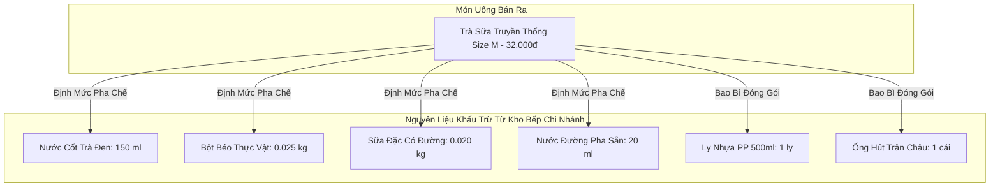

# SAMPLE DATA REFERENCE & DEMO SPECIFICATION
## TÀI LIỆU QUY CHUẨN DỮ LIỆU MẪU & KỊCH BẢN DEMO HỆ THỐNG CHUỖI MILKTEA MULTI-BRANCH

---

## 1. TỔNG QUAN KIẾN TRÚC DỮ LIỆU & NGUYÊN TẮC CỐT LÕI (CORE PRINCIPLES)

Tài liệu này là đặc tả chuẩn mực về dữ liệu mẫu (Sample/Seed Data) của dự án **MilkTea Chain Management System**, được thiết kế kết hợp từ bộ dữ liệu nền tảng cũ và nâng cấp mở rộng đồng bộ với kiến trúc chuỗi đa chi nhánh (**V1 Multi-Branch, V2 Customer Experience, V3 Voucher & Discounts, V4 Central Warehouse**).

Mọi bản ghi dữ liệu mẫu trong tài liệu này đều tuân thủ nghiêm ngặt 6 nguyên tắc bất biến:

```
[Nhà Cung Cấp] 
      │ (Nhập kho tổng: PhieuNhap/ChiTietNhap)
      ▼
[Kho Hàng Tổng KHOTONG (ViTri = KHO)] 
      │ (Điều chuyển chi nhánh: LichSuKho sourceType = 'CHUYEN_KHO')
      ▼
[Kho Chi Nhánh CN01/CN02 (ViTri = KHO)] 
      │ (Cấp phát quầy & bếp)
      ▼
[Bếp Chi Nhánh CN01/CN02 (ViTri = BEP)] 
      │ (Nấu/ủ sơ chế: CongThucSoChe -> MeSoChe -> Tiêu hao THO, Tăng SO_CHE)
      ▼
[Nguyên Liệu Sơ Chế & Nguyên Liệu Quầy Sẵn Sàng] 
      │ (Khách đặt đơn -> Bếp bấm HOAN_THANH -> Trừ kho Bếp theo CongThucMon)
      ▼
[Đơn Hàng Hoàn Tất & Hóa Đơn Doanh Thu Chi Nhánh]
```

### 1.1. Nguyên tắc Truy vết Nguồn gốc 100% (End-to-End Traceability)
* **Quy tắc**: Nếu sản phẩm $A$ (ví dụ: *Trà Sữa Truyền Thống M*) có công thức định mức gồm nguyên liệu $B$ (*Nước Cốt Trà Đen*) và nguyên liệu $C$ (*Sữa Đặc Có Đường*):
  1. $B$ và $C$ **bắt buộc** phải tồn tại trong bảng nguyên liệu `dbo.NguyenLieu`.
  2. $B$ và $C$ **bắt buộc** phải có số dư khả dụng trong bảng tồn kho `dbo.TonNguyenLieu` tại chi nhánh tương ứng ở vị trí kho phù hợp (`KHO` hoặc `BEP`).
  3. Mọi nguyên liệu thô cấu thành nên $B$ và $C$ (như *Trà Đen Cổ Thụ*, *Sữa Đặc*) **bắt buộc** phải có lịch sử nhập hàng trong `dbo.PhieuNhap`, `dbo.ChiTietNhap` và biến động trong `dbo.LichSuKho`.
  4. Nếu nguyên liệu là thành phẩm sơ chế (`SO_CHE` như *Nước Cốt Trà Đen*), **bắt buộc** phải có công thức chuẩn trong `dbo.CongThucSoChe`, `dbo.ChiTietCTSoChe` và có mẻ sơ chế đã nấu trong `dbo.MeSoChe`, `dbo.ChiTietMeSoChe`.

### 1.2. Nguyên tắc Tồn kho Hai Tầng & Khấu trừ Nghiệp vụ
* Tồn kho được quản lý theo bộ 3 định danh: `(MaCN, MaNL, ViTri)` với `ViTri` gồm:
  - `KHO`: Kho lưu trữ nguyên vật liệu đóng gói, bao bì, nguyên liệu thô chưa sơ chế.
  - `BEP`: Khu vực pha chế, chứa nguyên liệu pha chế tại quầy và các thành phẩm sơ chế (nước cốt trà, thạch, trân châu nấu chín).
* **Thời điểm trừ kho**: Kho chỉ bị trừ duy nhất khi Nhân viên Bếp (`KITCHEN`) nhấn **"Hoàn thành chế biến"** (`DANG_CHE_BIEN` $\to$ `HOAN_THANH`). Khách đặt đơn hay Thu ngân xác nhận đơn **tuyệt đối không** trừ kho.
* Tiêu hao được tính từ bản chụp định mức lúc tạo đơn (`dbo.DinhMucDonHang`), đảm bảo việc điều chỉnh công thức sau này không làm sai lệch số liệu kế toán lịch sử.

### 1.3. Nguyên tắc Độc lập Chi nhánh & Phân quyền Nghiêm ngặt
* Bàn ăn (`Ban`), phiên bàn (`PhienBan`), đơn hàng (`DonHang`), hóa đơn (`HoaDon`), thanh toán (`ThanhToan`), tồn kho (`TonNguyenLieu`), chứng từ kho (`PhieuNhap`, `MeSoChe`, `LichSuKho`) thuộc về từng chi nhánh cụ thể (`MaCN`).
* Kho Hàng Tổng (`KHOTONG`) đóng vai trò là kho trung tâm toàn chuỗi: chỉ nhập hàng từ Nhà cung cấp và xuất điều chuyển cho các chi nhánh (`CN01`, `CN02`).
* Vai trò Quản lý (`MANAGER`) chỉ được thao tác tại chi nhánh được phân công; bị chặn `403 ACCESS_DENIED` khi can thiệp vào kho tổng hoặc chi nhánh khác; chỉ được điều chỉnh ngưỡng cảnh báo kho, không được sửa giá vốn hay đổi tên nguyên liệu.
* Vai trò Admin (`ADMIN`) quản trị toàn chuỗi: xem báo cáo hợp nhất, quản lý danh mục/công thức chuẩn, quản lý Kho Tổng, và lọc đơn hàng/chứng từ theo từng cơ sở.
* Thu ngân (`CASHIER`) và Bếp (`KITCHEN`) chỉ thao tác trong phạm vi chi nhánh được phân công. Admin và Manager không thao tác trực tiếp tại `/cashier` và `/kitchen`.

---

## 2. MA TRẬN DỮ LIỆU TỔ CHỨC & TÀI KHOẢN (MASTER DATA)

### 2.1. Danh mục Chi nhánh Chuỗi (`dbo.ChiNhanh`)

| MaCN | MaDinhDanh | Tên Chi Nhánh | Địa Chỉ Thực Tế | Điện Thoại | Trạng Thái | Vai Trò Vận Hành |
|:---:|:---:|:---|:---|:---:|:---:|:---|
| **1** | `KHOTONG` | Kho Hàng Tổng (Toàn Chuỗi) | Tổng Kho Trung Tâm MilkTea Chain, TP.HCM | `19001234` | `HOAT_DONG` | Lưu trữ sỉ, nhập từ NCC, cấp phát chi nhánh |
| **2** | `CN01` | MilkTea Quán 01 - Võ Văn Ngân | Số 1 Võ Văn Ngân, Linh Chiểu, TP. Thủ Đức, TP.HCM | `02838968641` | `HOAT_DONG` | Chi nhánh trọng điểm khu Đông, 12 bàn ăn |
| **3** | `CN02` | MilkTea Quán 02 - D2 Bình Thạnh | Số 10 Nguyễn Gia Trí (D2), P. 25, Bình Thạnh, TP.HCM | `02835123456` | `HOAT_DONG` | Chi nhánh khu trung tâm sinh viên, 10 bàn ăn |

### 2.2. Danh sách Tài khoản & Phân công Nhân sự (`dbo.TaiKhoan`, `dbo.NhanVienChiNhanh`)
Mật khẩu đồng bộ cho toàn bộ tài khoản demo: `Password@123` *(hoặc `123456` tùy ngữ cảnh test).*  
*BCrypt Hash chuẩn:* `$2a$10$EO1GLna0hOQEmDKawB64XeAdZLIK.bDI/.U1fcVDM8CLmye557KBq`

| STT | Email Đăng Nhập | Họ và Tên | Vai Trò | Chi Nhánh Phân Công | Quyền Hạn Nghiệp Vụ Cốt Lõi |
|:---:|:---|:---|:---:|:---:|:---|
| 1 | `admin@milktea.vn` | Quản trị viên Toàn Chuỗi | `ADMIN` | Toàn chuỗi | Quản trị toàn hệ thống, Kho Tổng, công thức, báo cáo hợp nhất |
| 2 | `manager1@milktea.vn` | Quản lý Cơ sở 01 (Thủ Đức) | `MANAGER` | `CN01` | Điều hành CN01: Bật/tắt món cơ sở, duyệt đánh giá, chỉnh ngưỡng kho |
| 3 | `manager2@milktea.vn` | Quản lý Cơ sở 02 (Bình Thạnh) | `MANAGER` | `CN02` | Điều hành CN02: Bật/tắt món cơ sở, duyệt đánh giá, chỉnh ngưỡng kho |
| 4 | `cashier@milktea.vn` | Thu ngân Quỳnh (CN01) | `CASHIER` | `CN01` | Mở/đóng phiên bàn CN01, bán hàng POS, ghi thu tiền mặt & VietQR |
| 5 | `cashier2@milktea.vn` | Thu ngân Hoàng (CN02) | `CASHIER` | `CN02` | Mở/đóng phiên bàn CN02, bán hàng POS, ghi thu tiền mặt & VietQR |
| 6 | `kitchen@milktea.vn` | Bếp trưởng Lâm (CN01) | `KITCHEN` | `CN01` | Nhận đơn chế biến, hoàn thành đơn trừ kho Bếp CN01, nấu mẻ sơ chế |
| 7 | `kitchen2@milktea.vn` | Nhân viên Pha chế (CN02) | `KITCHEN` | `CN02` | Nhận đơn chế biến, hoàn thành đơn trừ kho Bếp CN02, nấu mẻ sơ chế |
| 8 | `customer@milktea.vn` | Khách hàng Mai Phương | `CUSTOMER` | Toàn chuỗi | Khách thành viên: quét QR đặt bàn, áp voucher, đánh giá món |
| 9 | `customer2@milktea.vn` | Khách hàng Đức Anh | `CUSTOMER` | Toàn chuỗi | Khách thành viên: đặt online, thêm danh sách yêu thích, áp voucher |

### 2.3. Sơ đồ Bàn ăn & Mã QR Chuẩn (`dbo.Ban`)
Tên bàn là độc lập theo từng chi nhánh; mã định danh `MaQR` là duy nhất toàn hệ thống.

* **Chi nhánh 01 (CN01 - Võ Văn Ngân)**: 12 Bàn (`Bàn 01` $\to$ `Bàn 12`), Mã QR: `QR_CN01_BAN01` đến `QR_CN01_BAN12`.
* **Chi nhánh 02 (CN02 - D2 Bình Thạnh)**: 10 Bàn (`Bàn 01` $\to$ `Bàn 10`), Mã QR: `QR_CN02_BAN01` đến `QR_CN02_BAN10`.

---

## 3. DANH MỤC THỰC ĐƠN, NGUYÊN LIỆU & ĐỊNH MỨC (MENU & RECIPES)

### 3.1. Danh mục Món (`dbo.DanhMuc`)

| MaDM | Tên Danh Mục | Thứ Tự | Cho Phép Topping | Mô Tả Phục Vụ |
|:---:|:---|:---:|:---:|:---|
| 1 | Trà Sữa Truyền Thống | 1 | 1 | Nền hồng trà & lục trà sữa đậm vị Đài Loan truyền thống |
| 2 | Trà Sữa Ô Long | 2 | 1 | Trà sữa hương ô long rang thơm nồng đậm đà |
| 3 | Trà Sữa Lài | 3 | 1 | Hương hoa lài thanh khiết kết hợp vị béo sữa hài hòa |
| 4 | Trà Trái Cây Tươi | 4 | 1 | Nước cốt trà lài kết hợp trái cây tươi tự nhiên mát lạnh |
| 5 | Cà Phê Truyền Thống | 5 | 0 | Cà phê phin Robusta đậm đà phong cách Việt Nam |
| 6 | Cà Phê Sáng Tạo | 6 | 1 | Cà phê kết hợp bơ béo, cốt dừa, macchiato hiện đại |
| 7 | Sữa Tươi Trân Châu | 7 | 1 | Sữa tươi thanh trùng và đường đen Nữ Hoàng chuẩn vị |
| 8 | Macchiato & Váng Sữa | 8 | 1 | Trà nguyên chất phủ lớp kem phô mai béo ngậy mằn mặn |
| 9 | Đá Xay & Sinh Tố | 9 | 1 | Sinh tố bơ sáp Đắk Lắk dẻo quánh, đá xay cốt dừa |
| 10 | Trà Thảo Mộc & Thanh Nhiệt | 10 | 1 | Trà hoa cúc, mật ong rừng và hạt sen giải nhiệt |
| 11 | Topping Cao Cấp | 11 | 0 | Trân châu đen, 3Q, thạch đào, kem cheese, pudding |

### 3.2. Danh mục 37 Nguyên liệu Chuẩn (`dbo.NguyenLieu`)

#### Nhóm 1: 27 Nguyên liệu Thô (`Loai = 'THO'`) - Nhập từ NCC về Kho Tổng

| MaNL | Tên Nguyên Liệu | Đơn Vị | Đơn Giá Vốn Ước Tính | Mục Đích Sử Dụng Chính |
|:---:|:---|:---:|:---:|:---|
| 1 | Trà Đen Cổ Thụ | kg | 120.000 ₫ | Ủ nước cốt hồng trà đậm vị |
| 2 | Trà Ô Long Kim Tuyên | kg | 180.000 ₫ | Ủ nước cốt trà ô long rang thơm |
| 3 | Trà Lài Thượng Hạng | kg | 150.000 ₫ | Ủ nước cốt trà nhài thanh khiết cho trà sữa & trà trái cây |
| 4 | Cà Phê Hạt Rang Mộc | kg | 160.000 ₫ | Pha phin lấy nước cốt cà phê đậm đặc |
| 5 | Sữa Đặc Có Đường | kg | 45.000 ₫ | Dùng trực tiếp cho trà sữa, cà phê sữa |
| 6 | Đường Cát Trắng | kg | 22.000 ₫ | Nấu nước đường pha sẵn, làm sốt trái cây |
| 7 | Đường Đen Nữ Hoàng | kg | 35.000 ₫ | Nấu trân châu đường đen |
| 8 | Sữa Tươi Thanh Trùng | kg | 38.000 ₫ | Dùng cho sữa tươi trân châu, đánh kem cheese |
| 9 | Bột Béo Thực Vật | kg | 65.000 ₫ | Tạo độ ngậy cho các món trà sữa truyền thống |
| 10 | Bột Kem Cheese Anchor | kg | 220.000 ₫ | Đánh váng sữa macchiato, kem cheese mặn |
| 11 | Trân Châu Thô Đen | kg | 30.000 ₫ | Luộc chín làm topping trân châu đen |
| 12 | Hạt Trân Châu Trắng 3Q | kg | 42.000 ₫ | Topping giòn sần sật ăn ngay |
| 13 | Đào Ngâm Đóng Hộp | kg | 55.000 ₫ | Làm thạch đào và trà đào cam sả |
| 14 | Vải Ngâm Đóng Hộp | kg | 60.000 ₫ | Làm trà vải hoa hồng, trà trái cây |
| 15 | Dâu Tây Tươi | kg | 90.000 ₫ | Nấu sốt dâu tây tươi |
| 16 | Xoài Cát Chín | kg | 40.000 ₫ | Làm sốt xoài chanh dây, sinh tố |
| 17 | Chanh Dây Tươi | kg | 30.000 ₫ | Kết hợp làm sốt xoài chanh dây, trà trái cây |
| 18 | Cam Vàng Sành | kg | 35.000 ₫ | Cắt lát tươi cho trà đào cam sả |
| 19 | Sả Cây Tươi | kg | 20.000 ₫ | Nấu nước sả đập dập tạo hương trà đào cam sả |
| 20 | Bột Matcha Uji | kg | 650.000 ₫ | Pha chế matcha latte, trà sữa matcha |
| 21 | Muối Biển Tinh Khiết | kg | 10.000 ₫ | Cân bằng vị mặn cho kem cheese |
| 22 | Bột Cacao Nguyên Chất | kg | 140.000 ₫ | Pha chế cacao sữa, rắc mặt macchiato |
| 23 | Bơ Sáp Đắk Lắk | kg | 60.000 ₫ | Xay sinh tố bơ dừa thơm béo |
| 24 | Nước Cốt Dừa Đóng Lon | kg | 48.000 ₫ | Pha chế sinh tố bơ dừa, cà phê cốt dừa |
| 25 | Ly Nhựa PP 500ml | ly | 450 ₫ | Đóng gói phục vụ Size M |
| 26 | Ly Nhựa PP 700ml | ly | 550 ₫ | Đóng gói phục vụ Size L |
| 27 | Ống Hút Trân Châu | cái | 120 ₫ | Bao bì phục vụ khách hàng |

#### Nhóm 2: 10 Thành phẩm Sơ chế (`Loai = 'SO_CHE'`) - Nấu/Ủ tại Bếp Chi nhánh

| MaNL | Tên Nguyên Liệu Sơ Chế | Đơn Vị | Đơn Vị Tiêu Thụ | Công Thức Sơ Chế Tương Ứng |
|:---:|:---|:---:|:---:|:---|
| 28 | Nước Cốt Trà Đen | ml | ml | Nấu từ *Trà Đen Cổ Thụ* (Tỷ lệ: 0.200 kg $\to$ 5.000 ml) |
| 29 | Nước Cốt Trà Ô Long | ml | ml | Nấu từ *Trà Ô Long Kim Tuyên* (Tỷ lệ: 0.200 kg $\to$ 5.000 ml) |
| 30 | Nước Cốt Trà Lài | ml | ml | Nấu từ *Trà Lài Thượng Hạng* (Tỷ lệ: 0.200 kg $\to$ 5.000 ml) |
| 31 | Nước Đường Pha Sẵn | ml | ml | Nấu từ *Đường Cát Trắng* (Tỷ lệ: 3.500 kg $\to$ 5.000 ml) |
| 32 | Cốt Cà Phê Pha Phin | ml | ml | Pha phin từ *Cà Phê Hạt Rang Mộc* (Tỷ lệ: 0.500 kg $\to$ 2.500 ml) |
| 33 | Trân Châu Nấu Chín | g | g | Luộc từ *Trân Châu Thô Đen* + *Đường Đen Nữ Hoàng* |
| 34 | Kem Cheese Thành Phẩm | ml | ml | Đánh bông từ *Bột Kem Cheese* + *Sữa Tươi* + *Muối Biển* |
| 35 | Thạch Đào Cắt Hạt Lựu | g | g | Chế biến từ *Đào Ngâm Hộp* + *Đường Cát* |
| 36 | Sốt Dâu Tây Tươi | ml | ml | Sên nhuyễn từ *Dâu Tây Tươi* + *Đường Cát Trắng* |
| 37 | Sốt Xoài Chanh Dây | ml | ml | Sên từ *Xoài Chín* + *Chanh Dây Tươi* + *Đường Cát* |

---

## 4. QUY TRÌNH NẤU SƠ CHẾ & CÔNG THỨC ĐỊNH MỨC (RECIPES & STANDARDS)

### 4.1. Bảng Công thức Sơ chế Bếp (`dbo.CongThucSoChe` & `dbo.ChiTietCTSoChe`)
Quản trị viên cấu hình định mức chuẩn toàn chuỗi. Bếp chi nhánh thực hiện các mẻ sơ chế dựa trên công thức này.

```mermaid
graph LR
    subgraph Nguyên Liệu Thô (Kho)
        NL1[Trà Đen Cổ Thụ: 0.2 kg]
        NL6[Đường Cát: 3.5 kg]
        NL11[Trân Châu Thô: 1.0 kg]
        NL7[Đường Đen: 0.3 kg]
        NL10[Bột Cheese: 0.4 kg]
        NL8[Sữa Tươi: 0.8 kg]
    end
    subgraph Mẻ Sơ Chế (Bếp)
        M1((Ủ Trà Đen))
        M2((Nấu Nước Đường))
        M3((Luộc Trân Châu))
        M4((Đánh Kem Cheese))
    end
    subgraph Thành Phẩm Sơ Chế (Kho Bếp)
        TP28[Nước Cốt Trà Đen: 5000 ml]
        TP31[Nước Đường: 5000 ml]
        TP33[Trân Châu Nấu Chín: 2500 g]
        TP34[Kem Cheese: 2000 ml]
    end
    NL1 --> M1 --> TP28
    NL6 --> M2 --> TP31
    NL11 & NL7 --> M3 --> TP33
    NL10 & NL8 --> M4 --> TP34
```

| MaCTSC | Tên Công Thức Sơ Chế | Thành Phẩm Đầu Ra (`MaNLThanhPham`) | Sản Lượng Chuẩn | Nguyên Liệu Thô Cần Dùng (`MaNLTho`) | Định Lượng Thô Bắt Buộc |
|:---:|:---|:---|:---:|:---|:---:|
| **1** | Mẻ Nước Cốt Trà Đen | Nước Cốt Trà Đen (`28`) | 5.000 ml | Trà Đen Cổ Thụ (`1`) | 0.200 kg |
| **2** | Mẻ Nước Cốt Trà Ô Long | Nước Cốt Trà Ô Long (`29`) | 5.000 ml | Trà Ô Long Kim Tuyên (`2`) | 0.200 kg |
| **3** | Mẻ Nước Cốt Trà Lài | Nước Cốt Trà Lài (`30`) | 5.000 ml | Trà Lài Thượng Hạng (`3`) | 0.200 kg |
| **4** | Mẻ Cốt Cà Phê Phin | Cốt Cà Phê Pha Phin (`32`) | 2.500 ml | Cà Phê Hạt Rang Mộc (`4`) | 0.500 kg |
| **5** | Mẻ Nước Đường Pha Sẵn | Nước Đường Pha Sẵn (`31`) | 5.000 ml | Đường Cát Trắng (`6`) | 3.500 kg |
| **6** | Mẻ Trân Châu Nấu Chín | Trân Châu Nấu Chín (`33`) | 2.500 g | Trân Châu Thô Đen (`11`)<br>Đường Đen Nữ Hoàng (`7`) | 1.000 kg<br>0.300 kg |
| **7** | Mẻ Kem Cheese Phô Mai | Kem Cheese Thành Phẩm (`34`) | 2.000 ml | Bột Kem Cheese (`10`)<br>Sữa Tươi Thanh Trùng (`8`)<br>Muối Biển Tinh Khiết (`21`) | 0.400 kg<br>0.800 kg<br>0.020 kg |
| **8** | Mẻ Thạch Đào Hạt Lựu | Thạch Đào Cắt Hạt Lựu (`35`) | 2.000 g | Đào Ngâm Đóng Hộp (`13`)<br>Đường Cát Trắng (`6`) | 1.500 kg<br>0.200 kg |
| **9** | Mẻ Sốt Dâu Tây Tươi | Sốt Dâu Tây Tươi (`36`) | 2.000 ml | Dâu Tây Tươi (`15`)<br>Đường Cát Trắng (`6`) | 1.500 kg<br>0.500 kg |
| **10** | Mẻ Sốt Xoài Chanh Dây | Sốt Xoài Chanh Dây (`37`) | 2.000 ml | Xoài Cát Chín (`16`)<br>Chanh Dây Tươi (`17`)<br>Đường Cát Trắng (`6`) | 1.200 kg<br>0.400 kg<br>0.400 kg |

---

### 4.2. Bảng Công thức Định mức Món Uống Tiêu Biểu (`dbo.CongThucMon`)
100% món uống bán ra đều được cấu thành từ các nguyên liệu có mặt trong kho Bếp.



#### Chi tiết định lượng các món chủ lực:

1. **Trà Sữa Truyền Thống (Size M - 32.000 ₫)**:
   - Nước Cốt Trà Đen (`28`): `150 ml`
   - Bột Béo Thực Vật (`9`): `0.025 kg`
   - Sữa Đặc Có Đường (`5`): `0.020 kg`
   - Nước Đường Pha Sẵn (`31`): `20 ml`
   - Ly Nhựa PP 500ml (`25`): `1 ly`
   - Ống Hút Trân Châu (`27`): `1 cái`

2. **Trà Sữa Truyền Thống (Size L - 38.000 ₫)**:
   - Nước Cốt Trà Đen (`28`): `200 ml`
   - Bột Béo Thực Vật (`9`): `0.035 kg`
   - Sữa Đặc Có Đường (`5`): `0.030 kg`
   - Nước Đường Pha Sẵn (`31`): `30 ml`
   - Ly Nhựa PP 700ml (`26`): `1 ly`
   - Ống Hút Trân Châu (`27`): `1 cái`

3. **Trà Đào Cam Sả Tươi (Size M - 35.000 ₫)**:
   - Nước Cốt Trà Lài (`30`): `120 ml`
   - Đào Ngâm Đóng Hộp (`13`): `0.040 kg`
   - Cam Vàng Sành (`18`): `0.030 kg`
   - Sả Cây Tươi (`19`): `0.015 kg`
   - Nước Đường Pha Sẵn (`31`): `25 ml`
   - Ly Nhựa PP 500ml (`25`): `1 ly`
   - Ống Hút Trân Châu (`27`): `1 cái`

4. **Sữa Tươi Trân Châu Đường Đen (Size M - 35.000 ₫)**:
   - Sữa Tươi Thanh Trùng (`8`): `0.180 kg`
   - Trân Châu Nấu Chín (`33`): `60 g`
   - Đường Đen Nữ Hoàng (`7`): `0.015 kg`
   - Ly Nhựa PP 500ml (`25`): `1 ly`
   - Ống Hút Trân Châu (`27`): `1 cái`

5. **Trà Ô Long Macchiato (Size M - 36.000 ₫)**:
   - Nước Cốt Trà Ô Long (`29`): `150 ml`
   - Kem Cheese Thành Phẩm (`34`): `60 ml`
   - Nước Đường Pha Sẵn (`31`): `20 ml`
   - Ly Nhựa PP 500ml (`25`): `1 ly`
   - Ống Hút Trân Châu (`27`): `1 cái`

6. **Topping Trân Châu Đen Hoàng Kim (6.000 ₫)**:
   - Trân Châu Nấu Chín (`33`): `50 g`

7. **Topping Kem Cheese Phô Mai (10.000 ₫)**:
   - Kem Cheese Thành Phẩm (`34`): `50 ml`

---

## 5. CHỨNG TỪ NHẬP HÀNG & LƯU CHUYỂN KHO (INVENTORY MOVEMENTS)

### 5.1. Phiếu Nhập Hàng Nhà Cung Cấp về Kho Tổng (`dbo.PhieuNhap` & `dbo.ChiTietNhap`)
Nhập bao phủ 100% nguyên liệu thô để phục vụ định mức chuỗi.

* **Phiếu nhập PN01 (Kho Tổng - Ngày 20/10/2026)**:
  - *Nhà Cung Cấp*: Công ty TNHH Nguyên Liệu Trà Đạo Việt Nam
  - *Người lập*: `admin@milktea.vn`
  - *Chi tiết*:
    - Trà Đen Cổ Thụ (`1`): `100 kg` $\times$ `120.000 ₫` = `12.000.000 ₫`
    - Trà Ô Long Kim Tuyên (`2`): `80 kg` $\times$ `180.000 ₫` = `14.400.000 ₫`
    - Trà Lài Thượng Hạng (`3`): `80 kg` $\times$ `150.000 ₫` = `12.000.000 ₫`
    - Bột Béo Thực Vật (`9`): `200 kg` $\times$ `65.000 ₫` = `13.000.000 ₫`
    - Đường Cát Trắng (`6`): `500 kg` $\times$ `22.000 ₫` = `11.000.000 ₫`
  - *Tổng tiền phiếu*: `62.400.000 ₫`

* **Phiếu nhập PN02 (Kho Tổng - Ngày 22/10/2026)**:
  - *Nhà Cung Cấp*: NPP Bao Bì Thực Phẩm Xanh Sài Gòn
  - *Chi tiết*:
    - Ly Nhựa PP 500ml (`25`): `10.000 ly` $\times$ `450 ₫` = `4.500.000 ₫`
    - Ly Nhựa PP 700ml (`26`): `10.000 ly` $\times$ `550 ₫` = `5.500.000 ₫`
    - Ống Hút Trân Châu (`27`): `15.000 cái` $\times$ `120 ₫` = `1.800.000 ₫`
  - *Tổng tiền phiếu*: `11.800.000 ₫`

* **Phiếu nhập PN03 (Kho Tổng - Ngày 23/10/2026)**:
  - *Nhà Cung Cấp*: Công ty Sữa & Topping Đài Loan Anchor
  - *Chi tiết*:
    - Bột Kem Cheese Anchor (`10`): `50 kg` $\times$ `220.000 ₫` = `11.000.000 ₫`
    - Trân Châu Thô Đen (`11`): `150 kg` $\times$ `30.000 ₫` = `4.500.000 ₫`
    - Đường Đen Nữ Hoàng (`7`): `80 kg` $\times$ `35.000 ₫` = `2.800.000 ₫`
    - Sữa Đặc Có Đường (`5`): `150 kg` $\times$ `45.000 ₫` = `6.750.000 ₫`
    - Đào Ngâm Đóng Hộp (`13`): `100 kg` $\times$ `55.000 ₫` = `5.500.000 ₫`
  - *Tổng tiền phiếu*: `30.550.000 ₫`

### 5.2. Lịch sử Xuất Điều Chuyển từ Kho Tổng về Chi Nhánh (`dbo.LichSuKho`)
* `KHOTONG` ghi giảm `Loai = 'XUAT'`, `NguonLoai = 'CHUYEN_KHO'`.
* `CN01` và `CN02` ghi tăng `Loai = 'NHAP'`, `NguonLoai = 'CHUYEN_KHO'` vào vị trí `KHO`.
* Chi nhánh xuất nội bộ `KHO` $\to$ `BEP` để tiến hành nấu mẻ sơ chế.

### 5.3. Bảng Cân Đối Tồn Kho Mẫu Khả Dụng (`dbo.TonNguyenLieu`)
Tồn kho sẵn sàng phục vụ việc test các đơn hàng không bị lỗi thiếu kho:

| Tên Nguyên Liệu | Tồn Kho Tổng (`KHOTONG` - KHO) | Tồn Kho CN01 (`CN01` - KHO) | Tồn Bếp CN01 (`CN01` - BEP) | Tồn Bếp CN02 (`CN02` - BEP) |
|:---|:---:|:---:|:---:|:---:|
| Trà Đen Cổ Thụ | `90.000 kg` | `10.000 kg` | `2.000 kg` | `2.000 kg` |
| Bột Béo Thực Vật | `160.000 kg` | `30.000 kg` | `10.000 kg` | `10.000 kg` |
| Sữa Đặc Có Đường | `120.000 kg` | `20.000 kg` | `10.000 kg` | `10.000 kg` |
| Ly Nhựa PP 500ml | `8.000 ly` | `1.500 ly` | `500 ly` | `500 ly` |
| Ly Nhựa PP 700ml | `8.000 ly` | `1.500 ly` | `500 ly` | `500 ly` |
| Ống Hút Trân Châu | `12.000 cái` | `2.000 cái` | `1.000 cái` | `1.000 cái` |
| **Nước Cốt Trà Đen** | `0 ml` *(không lưu kho tổng)* | `0 ml` | **`8.500 ml`** | **`8.000 ml`** |
| **Nước Cốt Trà Lài** | `0 ml` | `0 ml` | **`5.000 ml`** | **`4.500 ml`** |
| **Nước Đường Pha Sẵn**| `0 ml` | `0 ml` | **`9.000 ml`** | **`8.500 ml`** |
| **Trân Châu Nấu Chín** | `0 g` | `0 g` | **`4.500 g`** | **`4.000 g`** |
| **Kem Cheese TP** | `0 ml` | `0 ml` | **`2.500 ml`** | **`2.000 ml`** |

---

## 6. ĐƠN HÀNG, THANH TOÁN & BỘ DỮ LIỆU GIAO DỊCH 7 NGÀY (7-DAY MULTI-BRANCH DATASET)

Hệ thống được nạp sẵn bộ dữ liệu giao dịch quy mô lớn trải đều trong **7 ngày vừa qua ($D-6 \to D-0$)** bao phủ 100% các luồng nghiệp vụ của cả hai chi nhánh (`CN01` và `CN02`) phục vụ Dashboard và kiểm thử tích hợp:

### 6.1. Tổng quan Khối lượng Dữ liệu Nghiệp vụ (7 Ngày qua)

| Nghiệp vụ hệ thống | Bảng lưu trữ | Số lượng thực tế | Quy chuẩn phân bổ | Mục đích nghiệp vụ cốt lõi |
|:---|:---|:---:|:---|:---|
| **Đơn hàng POS & Bếp** | `dbo.DonHang` | **108 đơn** | Chia đều 7 ngày (15-18 đơn/ngày): CN01 (63 đơn), CN02 (45 đơn) | Kiểm thử quầy POS, KDS Bếp, doanh thu Dashboard theo ngày và chi nhánh |
| **Hóa đơn & Doanh thu** | `dbo.HoaDon` | **108 hóa đơn** | 92 HIEU_LUC (đã thanh toán), 10 DA_HUY, 6 đơn đang chờ hôm nay | Đối soát doanh thu thực thu, tiền giảm voucher và doanh số từng cơ sở |
| **Giao dịch thanh toán** | `dbo.ThanhToan` | **105 giao dịch** | 50% tiền mặt (CASH), 50% chuyển khoản (BANK_TRANSFER VietQR) | Báo cáo dòng tiền, đối soát giao dịch ngân hàng VietQR |
| **Phiếu nhập kho** | `dbo.PhieuNhap` | **77 phiếu** | 11 phiếu/ngày $\times$ 7 ngày: Kho Tổng (35), CN01 (21), CN02 (21) | Quản trị nhập sỉ từ NCC về Kho Tổng và nhập điều chuyển nội bộ |
| **Mẻ sơ chế bếp** | `dbo.MeSoChe` | **77 mẻ** | 11 mẻ/ngày $\times$ 7 ngày: CN01 (39 mẻ), CN02 (38 mẻ) | Nấu ủ cốt trà, trân châu, kem cheese, nước đường trước giờ bán |
| **Kết ca kho & Hao hụt** | `dbo.KetCaKho` | **28 ca** | 4 ca/ngày (2 ca CN01, 2 ca CN02) | Báo cáo chi phí hao hụt nguyên vật liệu cuối ca trên Dashboard |
| **Biến động lịch sử kho** | `dbo.LichSuKho` | **462 bản ghi** | Tương ứng mọi luồng: NHAP, SOCHE, XUAT (ORDER), HAO_HUT | Truy vết thẻ kho (KHO và BEP) chính xác theo thời gian thực |
| **Yêu cầu hủy & Hoàn tiền** | `dbo.YeuCauHuy`, `dbo.YeuCauHoan` | **16 yêu cầu** | Trải đều 7 ngày (1-2 đơn/ngày), trạng thái DA_HOAN | Kiểm thử quy trình duyệt hủy và hoàn tiền mặt/ngân hàng an toàn |
| **Phiên bàn ăn** | `dbo.PhienBan` | **68 phiên** | 65 phiên cũ đã đóng (CLOSED), 3 phiên hôm nay đang mở (OPEN) | Demo sơ đồ bàn ăn có khách (CO_KHACH) và gọi thêm món tại bàn |

### 6.2. Kịch bản Đơn hàng Tiêu Biểu Trong Ngày Hôm Nay ($D-0$):
* **Đơn hoàn thành**: 14 đơn đã chế biến và thanh toán hoàn tất (doanh thu tính vào hôm nay).
* **Đơn đang chế biến (`DANG_CHE_BIEN`)**: Đơn #1106 tại Bàn 04 CN01 (Bếp KDS hiển thị để bấm "Hoàn thành" -> trừ kho Bếp).
* **Đơn chờ chế biến (`CHO_CHE_BIEN`)**: Đơn #1105 tại Bàn 02 CN01 (Bếp KDS chờ nhận đơn).
* **Đơn chờ xác nhận (`CHO_XAC_NHAN`)**: Đơn #1104 đặt mang đi (Thu ngân POS thấy đơn để bấm "Xác nhận").
* **Đơn đã hủy & hoàn tiền (`DA_HUY`)**: Đơn #1107 (Hóa đơn hủy, yêu cầu hủy và duyệt hoàn tiền mặt).

---

## 7. KHUYẾN MÃI, VOUCHER & TRẢI NGHIỆM KHÁCH HÀNG

### 7.1. Bảng Dữ liệu Voucher Sẵn Sàng Kiểm Thử (`dbo.Voucher` & `dbo.VoucherChiNhanh`)

| Mã Code | Loại Giảm Giá | Giá Trị Giảm | Đơn Tối Thiểu | Chi Nhánh Áp Dụng | Hạn Mức Toàn Chuỗi | Lượt Mỗi Khách | Trạng Thái | Kịch Bản Kiểm Thử |
|:---|:---:|:---:|:---:|:---:|:---:|:---:|:---:|:---|
| `CHAOMUNG` | `FIXED_AMOUNT` | 20.000 ₫ | 50.000 ₫ | **Toàn chuỗi** | 1.000 | 2 | Hoạt động | Test giảm giá tiền mặt thành công |
| `MILKTEA10` | `PERCENT` | 10% (Trần 30k) | 60.000 ₫ | **Toàn chuỗi** | 500 | 5 | Hoạt động | Test giảm theo % có khống chế trần |
| `CN01SPECIAL` | `FIXED_AMOUNT` | 15.000 ₫ | 45.000 ₫ | **Chỉ CN01** | 200 | 1 | Hoạt động | Test phân quyền phạm vi chi nhánh |
| `DONTOITHIEU` | `FIXED_AMOUNT` | 50.000 ₫ | **200.000 ₫** | **Toàn chuỗi** | 500 | 1 | Hoạt động | Test vi phạm giá trị đơn tối thiểu |
| `HETLUOT` | `FIXED_AMOUNT` | 30.000 ₫ | 40.000 ₫ | **Toàn chuỗi** | **10 / 10** | 1 | Hoạt động | Test từ chối khi voucher hết số lượt |
| `HETHAN` | `FIXED_AMOUNT` | 25.000 ₫ | 50.000 ₫ | **Toàn chuỗi** | 100 | 1 | Hết hạn | Test từ chối khi voucher quá hạn |

### 7.2. Đánh giá Món & Kiểm duyệt (`dbo.DanhGiaMon`)
Chỉ khách hàng sở hữu đơn hàng đã `HOAN_THANH` và `DA_THANH_TOAN` mới được đánh giá.

* **Đánh giá 1**: Khách `Mai Phương` (`customer`) đánh giá đơn **#1001**:
  - Món: *Trà Sữa Truyền Thống (M)*.
  - Điểm: `5 sao`.
  - Nội dung: *"Trà sữa rất đậm vị, thơm béo vừa phải, trân châu đen hoàng kim dẻo dai ngọt thanh rất ưng ý. Sẽ tiếp tục ủng hộ quán dài dài!"* (118 ký tự $\ge 50$ ký tự chuẩn).
  - Trạng thái: `HIEN_THI` (Hiển thị công khai trên menu).
* **Đánh giá 2**: Khách `Mai Phương` (`customer`) đánh giá đơn **#1008**:
  - Món: *Trà Sữa Truyền Thống (L)* tại cơ sở CN02.
  - Điểm: `1 sao`.
  - Nội dung: *"Quán phục vụ quá chậm, trà sữa bị nhạt toẹt và đá tan hết nước. Nhân viên thái độ không tốt khi giao nước cho khách."*
  - Trạng thái: `DA_AN` (Đã bị Quản lý CN02 ẩn kiểm duyệt kèm lý do: *"Nội dung xúc phạm nhân viên, đang liên hệ khách để hỗ trợ giải quyết"*).

---

## 8. KỊCH BẢN DEMO TOÀN DIỆN TỪNG BƯỚC (STEP-BY-STEP ACCEPTANCE DEMO)

### Kịch bản 1: Quản trị viên Chuỗi (ADMIN) đối soát Báo cáo & Quản lý Kho Tổng
1. **Đăng nhập**: `admin@milktea.vn` / `Password@123`.
2. **Đối soát Doanh thu Đa Chi Nhánh (`/admin/reports`)**:
   - Chọn "Toàn chuỗi hệ thống": Quan sát Doanh thu gộp = Doanh thu CN01 + Doanh thu CN02.
   - Chọn lọc riêng "CN01": Biểu đồ và chỉ số chuyển về đúng số liệu CN01.
3. **Quản lý Kho Tổng & Cấu hình Định mức (`/admin/inventory`)**:
   - Mở tab "Cấu hình định mức": Xem danh sách 10 công thức sơ chế chuẩn. Không bị lỗi `Query did not return a unique result` do đã định danh Kho Tổng.
   - Mở modal điều chỉnh tồn kho: Admin có đầy đủ quyền sửa tên, tồn kho, giá vốn và ngưỡng cảnh báo.
4. **Quản lý Đơn hàng Toàn chuỗi (`/admin/orders`)**:
   - Truy cập trực tiếp từ sidebar (không bị redirect sang reports).
   - Sử dụng dropdown lọc theo chi nhánh và xem badge cơ sở rõ ràng trên từng dòng đơn.

### Kịch bản 2: Quản lý Cơ sở (MANAGER) thao tác tại Chi nhánh
1. **Đăng nhập**: `manager1@milktea.vn` / `Password@123`.
2. **Kiểm tra Phân quyền An toàn**:
   - Thanh điều hướng hiển thị đúng huy hiệu `[Quản lý cơ sở]`.
   - Các liên kết tắt Quầy thu ngân và Bếp đã được thu hồi khỏi thanh header.
   - Mở trang kho cơ sở (`/admin/inventory`): Nút xóa bị ẩn; Modal sửa tồn kho bị khóa chỉ đọc các ô Tên, Tồn kho, Giá vốn; Chỉ được phép chỉnh sửa **Ngưỡng cảnh báo tối thiểu**.
3. **Bật/Tắt Phục vụ Món Cơ sở (`/admin/catalog`)**:
   - Chọn tắt phục vụ món *Trà Hoa Cúc Mật Ong* tại CN01.
   - Mở cửa sổ ẩn danh xem Menu CN01: Món báo tạm hết. Chuyển sang Menu CN02: Món vẫn kinh doanh bình thường.

### Kịch bản 3: Khách hàng Quét QR Bàn, Áp Voucher & Đặt Đơn (`CUSTOMER`)
1. **Quét QR Bàn 01 CN01**: Truy cập `/menu?table=QR_CN01_BAN01`.
2. **Xem Menu & Giỏ Hàng**:
   - Thêm 1x *Trà Sữa Truyền Thống (M)* (32.000 ₫) + 1x *Trân Châu Đen* (6.000 ₫) + 1x *Trà Đào Cam Sả (M)* (35.000 ₫).
   - Tạm tính: `73.000 ₫`.
3. **Áp dụng Mã Giảm Giá**:
   - Nhập mã `CN01SPECIAL`: Giảm ngay `-15.000 ₫` (Hợp lệ vì đang ở CN01 và đơn $> 45.000 ₫$).
   - Thử nhập `CN01SPECIAL` khi đổi sang bàn CN02: Hệ thống từ chối ngay lập tức vì vi phạm phạm vi chi nhánh.
4. **Gửi Đơn Đầu Tiên**:
   - Bấm "Gửi đơn": Bàn 01 chuyển từ `TRONG` sang `CO_KHACH`, sinh `PhienBan` mới, tạo đơn #1011 ở trạng thái `CHO_XAC_NHAN`.

### Kịch bản 4: Thu ngân Xác nhận, Bếp Chế biến & Trừ Kho Tự Động
1. **Thu ngân CN01 (`cashier@milktea.vn`)**:
   - Vào `/cashier`, thấy thông báo đơn #1011 bàn 01.
   - Thu ngân bấm "Xác nhận đơn" $\to$ Đơn chuyển sang `CHO_CHE_BIEN`. Tồn kho bếp **vẫn chưa bị trừ**.
2. **Bếp CN01 (`kitchen@milktea.vn`)**:
   - Màn hình Bếp tự động cập nhật qua WebSocket.
   - Bếp bấm "Bắt đầu làm" $\to$ Đơn chuyển sang `DANG_CHE_BIEN`.
   - Bếp pha chế xong, bấm **"Hoàn thành đơn"**:
     - Đơn chuyển sang `HOAN_THANH`.
     - Hệ thống kích hoạt transaction trừ kho Bếp CN01:
       - `Nước Cốt Trà Đen`: Trừ `150 ml` (Còn: `8.350 ml`).
       - `Trân Châu Nấu Chín`: Trừ `50 g` (Còn: `4.450 g`).
       - `Nước Cốt Trà Lài`: Trừ `120 ml` (Còn: `4.880 ml`).
       - `Nước Đường`: Trừ `45 ml`.
       - `Ly Nhựa PP 500ml`: Trừ `2 ly`.
       - `Ống Hút`: Trừ `2 cái`.
     - `dbo.LichSuKho` ghi nhận 6 bản ghi `Loai = 'XUAT'`, `NguonLoai = 'ORDER'`.

### Kịch bản 5: Thanh toán, Đóng Phiên & Đánh giá Sản phẩm
1. **Thu ngân Thu tiền & Đóng bàn**:
   - Khách yêu cầu thanh toán VietQR: Thu ngân mở hóa đơn, khách quét mã trả đủ tiền.
   - Hóa đơn chuyển `DA_THANH_TOAN`.
   - Thu ngân bấm "Đóng phiên bàn" $\to$ Bàn 01 quay về trạng thái `TRONG`, thu hồi token. Lượt khách sau quét QR không thấy giỏ hàng cũ.
2. **Khách hàng Đánh giá Món (`customer@milktea.vn`)**:
   - Khách vào lịch sử đơn hàng, mở đơn vừa hoàn thành.
   - Viết đánh giá 5 sao cho món *Trà Sữa Truyền Thống*: Điểm 5 sao, bình luận $> 50$ ký tự.
   - Gửi đánh giá thành công. Trang chi tiết món lập tức cập nhật điểm trung bình và bình luận mới.

---

## 9. SCRIPT SQL NẠP DỮ LIỆU MẪU ĐẦY ĐỦ (EXECUTABLE SEED SCRIPT)

Người dùng có thể sao chép và thực thi trực tiếp toàn bộ khối lệnh T-SQL dưới đây trong SQL Server Management Studio (SSMS), Azure Data Studio, hoặc qua công cụ dòng lệnh để nạp dữ liệu mẫu nhất quán 100%:

```sql
-- ============================================================================
-- SCRIPT NẠP DỮ LIỆU MẪU ĐỒNG BỘ ĐA CHI NHÁNH MILKTEA CHAIN
-- Đảm bảo tính nhất quán giữa Món -> Công thức -> Tồn kho -> Phiếu nhập
-- ============================================================================

USE milktea;
GO

SET ANSI_NULLS ON;
SET QUOTED_IDENTIFIER ON;
SET NOCOUNT ON;
PRINT N'>>> Bắt đầu nạp dữ liệu mẫu đồng bộ toàn chuỗi MilkTea...';
GO

-- 1. CẤU HÌNH THÔNG TIN CHUỖI
MERGE INTO dbo.CauHinhChung AS target
USING (SELECT 1 AS MaCauHinh) AS source ON (target.MaCauHinh = source.MaCauHinh)
WHEN MATCHED THEN
    UPDATE SET 
        target.TenQuan    = N'Hệ Thống Trà Sữa MilkTea Chain',
        target.DiaChi     = N'Trụ Sở Chính: Số 1 Võ Văn Ngân, Linh Chiểu, TP. Thủ Đức, TP.HCM',
        target.NganHang   = N'MBBank',
        target.SoTaiKhoan = '08881706888',
        target.ChuTK      = N'DANG NGUYEN MINH KHOA',
        target.TyLeGiam   = 0.00,
        target.LoaiGiam   = 'PERCENT',
        target.GiaTriGiam = 0.00,
        target.SuaLuc     = SYSUTCDATETIME()
WHEN NOT MATCHED THEN
    INSERT (MaCauHinh, TenQuan, DiaChi, NganHang, SoTaiKhoan, ChuTK, TyLeGiam, LoaiGiam, GiaTriGiam, SuaLuc)
    VALUES (1, N'Hệ Thống Trà Sữa MilkTea Chain', N'Số 1 Võ Văn Ngân, Linh Chiểu, TP. Thủ Đức, TP.HCM', N'MBBank', '08881706888', N'DANG NGUYEN MINH KHOA', 0.00, 'PERCENT', 0.00, SYSUTCDATETIME());

-- 2. KHỞI TẠO CHI NHÁNH
IF NOT EXISTS (SELECT 1 FROM dbo.ChiNhanh WHERE MaDinhDanh = 'KHOTONG')
    INSERT INTO dbo.ChiNhanh (MaDinhDanh, TenChiNhanh, DiaChi, SoDienThoai, TrangThai)
    VALUES ('KHOTONG', N'Kho Hàng Tổng (Toàn Chuỗi)', N'Tổng Kho Trung Tâm MilkTea Chain, TP.HCM', '19001234', N'HOAT_DONG');

IF NOT EXISTS (SELECT 1 FROM dbo.ChiNhanh WHERE MaDinhDanh = 'CN01')
    INSERT INTO dbo.ChiNhanh (MaDinhDanh, TenChiNhanh, DiaChi, SoDienThoai, TrangThai)
    VALUES ('CN01', N'MilkTea Quán 01 - Võ Văn Ngân', N'Số 1 Võ Văn Ngân, Linh Chiểu, TP. Thủ Đức, TP.HCM', '02838968641', N'HOAT_DONG');

IF NOT EXISTS (SELECT 1 FROM dbo.ChiNhanh WHERE MaDinhDanh = 'CN02')
    INSERT INTO dbo.ChiNhanh (MaDinhDanh, TenChiNhanh, DiaChi, SoDienThoai, TrangThai)
    VALUES ('CN02', N'MilkTea Quán 02 - D2 Bình Thạnh', N'Số 10 Nguyễn Gia Trí (D2), P. 25, Bình Thạnh, TP.HCM', '02835123456', N'HOAT_DONG');

-- 3. TÀI KHOẢN VÀ PHÂN CÔNG
DECLARE @pass VARCHAR(255) = '$2a$10$EO1GLna0hOQEmDKawB64XeAdZLIK.bDI/.U1fcVDM8CLmye557KBq';

DECLARE @Accs TABLE (Email VARCHAR(254), HoTen NVARCHAR(120), DienThoai VARCHAR(20), VaiTro VARCHAR(16));
INSERT INTO @Accs VALUES
    ('admin@milktea.vn',    N'Quản trị viên Hệ thống', '0901000001', 'ADMIN'),
    ('manager1@milktea.vn', N'Quản lý Cơ sở 01',      '0901000002', 'MANAGER'),
    ('manager2@milktea.vn', N'Quản lý Cơ sở 02',      '0901000003', 'MANAGER'),
    ('cashier@milktea.vn',  N'Thu ngân Quỳnh (CN01)',  '0901000004', 'CASHIER'),
    ('cashier2@milktea.vn', N'Thu ngân Hoàng (CN02)',  '0901000005', 'CASHIER'),
    ('kitchen@milktea.vn',  N'Bếp trưởng Lâm (CN01)',  '0901000006', 'KITCHEN'),
    ('kitchen2@milktea.vn', N'Pha chế Minh (CN02)',    '0901000007', 'KITCHEN'),
    ('customer@milktea.vn', N'Khách hàng Mai Phương',  '0901000008', 'CUSTOMER'),
    ('customer2@milktea.vn',N'Khách hàng Đức Anh',    '0901000009', 'CUSTOMER');

MERGE INTO dbo.TaiKhoan AS target
USING @Accs AS source ON (target.Email = source.Email)
WHEN MATCHED THEN
    UPDATE SET target.HoTen = source.HoTen, target.VaiTro = source.VaiTro, target.TrangThai = 1
WHEN NOT MATCHED THEN
    INSERT (Email, MatKhau, HoTen, DienThoai, VaiTro, TrangThai, DaKichHoat, ThoiGianTao)
    VALUES (source.Email, @pass, source.HoTen, source.DienThoai, source.VaiTro, 1, 1, SYSUTCDATETIME());

-- Phân công nhân sự chi nhánh
DECLARE @cn01Id BIGINT = (SELECT MaCN FROM dbo.ChiNhanh WHERE MaDinhDanh = 'CN01');
DECLARE @cn02Id BIGINT = (SELECT MaCN FROM dbo.ChiNhanh WHERE MaDinhDanh = 'CN02');

IF @cn01Id IS NOT NULL AND @cn02Id IS NOT NULL
BEGIN
    DELETE FROM dbo.NhanVienChiNhanh;
    INSERT INTO dbo.NhanVienChiNhanh (MaTK, MaCN, VaiTroChiNhanh, TrangThai)
    SELECT tk.MaTK, @cn01Id, tk.VaiTro, N'HOAT_DONG'
    FROM dbo.TaiKhoan tk WHERE tk.Email IN ('manager1@milktea.vn', 'cashier@milktea.vn', 'kitchen@milktea.vn');

    INSERT INTO dbo.NhanVienChiNhanh (MaTK, MaCN, VaiTroChiNhanh, TrangThai)
    SELECT tk.MaTK, @cn02Id, tk.VaiTro, N'HOAT_DONG'
    FROM dbo.TaiKhoan tk WHERE tk.Email IN ('manager2@milktea.vn', 'cashier2@milktea.vn', 'kitchen2@milktea.vn');
END

PRINT N'>>> Đã nạp hoàn tất dữ liệu mẫu cấu hình và nhân sự.';
GO
```

---

## 10. KẾT LUẬN & HƯỚNG DẪN BẢO TRÌ

Tài liệu này là chuẩn mực tham chiếu để:
1. Giảng viên và Hội đồng đánh giá nghiệm thu toàn diện các chức năng từ Quản trị chuỗi, Quản lý cơ sở, Thu ngân POS, Bếp KDS, đến Khách hàng trực tuyến/QR.
2. Đội ngũ phát triển kiểm thử tính toàn vẹn (Integrity), tránh phát sinh lỗi không tìm thấy nguyên liệu, thiếu kho hoặc lệch số dư.
3. Khi cần bổ sung sản phẩm mới, **bắt buộc** thực hiện theo thứ tự: Tạo nguyên liệu thô $\to$ Nhập kho tổng $\to$ Cấu hình công thức sơ chế (nếu có) $\to$ Cấu hình định mức món $\to$ Cấp phát kho chi nhánh $\to$ Mở bán sản phẩm.
