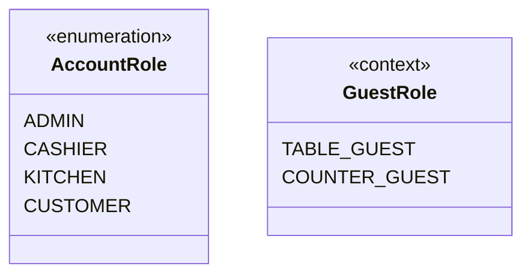
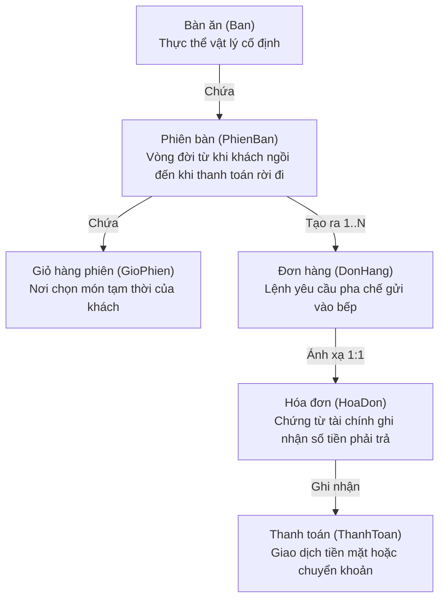

# PHẦN 1: TỔNG QUAN HỆ THỐNG, BÀI TOÁN NGHIỆP VỤ VÀ PHÂN TÍCH CÔNG NGHỆ

> **Tài liệu phục vụ Báo cáo & Bảo vệ Đồ án Tốt nghiệp / Cuối kỳ**  
> **Hệ thống:** MilkTea Management System — Nền tảng Quản trị & Bán hàng Trà sữa O2O Toàn diện  
> **Nhóm thực hiện:** Nhóm 03 (5 thành viên: Đặng Nguyễn Minh Khoa, Lê Văn Lân, Tôn Nữ Phương Quỳnh, Nguyễn Thị Trúc Mai, Nguyễn Thế Nam)  
> **Hình thức phân tích:** Phân tích tĩnh chuyên sâu mã nguồn (Static Code Analysis), đối chiếu tài liệu đặc tả, kiểm tra lịch sử Git (73 commits) và cấu hình thực tế. Không can thiệp sửa đổi mã nguồn hoặc database.

---

## MỤC LỤC PHẦN 1
1. [Nguồn Phân Tích, Độ Tin Cậy & Đối Chiếu Hiện Trạng](#1-nguồn-phân-tích-độ-tin-cậy--đối-chiếu-hiện-trạng)
   - 1.1. Căn cứ dữ liệu phân tích
   - 1.2. Phân định 4 cấp độ tin cậy của thông tin
   - 1.3. Bảng đối chiếu các điểm khác biệt giữa Báo cáo và Mã nguồn thực tế
2. [Bài Toán Thực Tế & Nghiệp Vụ Cửa Hàng Trà Sữa](#2-bài-toán-thực-tế--nghiệp-vụ-cửa-hàng-trà-sữa)
   - 2.1. Nỗi đau khi vận hành thủ công tại các quán F&B vừa và nhỏ
   - 2.2. Hệ thống MilkTea giải quyết triệt để những bài toán nào?
   - 2.3. Các đối tượng tác nhân, quyền hạn và trách nhiệm trong hệ thống
   - 2.4. Phạm vi đã hoàn thiện và giới hạn hệ thống
   - 2.5. Làm rõ các khái niệm nghiệp vụ dễ nhầm lẫn
   - 2.6. Phân tích chi tiết từng phân hệ nghiệp vụ thực tế
3. [Phân Tích Công Nghệ & Kiến Trúc Hệ Thống](#3-phân-tích-công-nghệ--kiến-trúc-hệ-thống)
   - 3.1. Bảng tổng hợp công nghệ và phiên bản thực tế
   - 3.2. Phân tích chi tiết từng công nghệ cốt lõi
   - 3.3. So sánh chuyên sâu các phương án công nghệ & Lý do lựa chọn

---

## 1. NGUỒN PHÂN TÍCH, ĐỘ TIN CẬY & ĐỐI CHIẾU HIỆN TRẠNG

### 1.1. Căn cứ dữ liệu phân tích
Phân tích này được thực hiện độc lập, khách quan dựa trên việc quét toàn diện các nguồn tài liệu và mã nguồn lưu trữ trong repository:
1. **Lịch sử Git**: Toàn bộ **73 commits** từ ngày khởi tạo (06/09/2026) đến commit mới nhất (21/10/2026), bao gồm tên tác giả, email, commit messages và diff chi tiết từng file.
2. **Mã nguồn thực tế**:
   - Backend: Toàn bộ cây thư mục Java tại [src/main/java/vn/edu/ute/milktea](file:///h:/UTE/Nam_3/v8/MilkTea_management_system/milktea/src/main/java/vn/edu/ute/milktea).
   - Tệp cấu hình: [pom.xml](file:///h:/UTE/Nam_3/v8/MilkTea_management_system/milktea/pom.xml), [application.yml](file:///h:/UTE/Nam_3/v8/MilkTea_management_system/milktea/src/main/resources/application.yml), [application-prod.yml](file:///h:/UTE/Nam_3/v8/MilkTea_management_system/milktea/src/main/resources/application-prod.yml).
   - Cơ sở dữ liệu: File DDL tạo bảng [database/1_schema.sql](file:///h:/UTE/Nam_3/v8/MilkTea_management_system/milktea/database/1_schema.sql), dữ liệu mẫu [database/full_demo_data.sql](file:///h:/UTE/Nam_3/v8/MilkTea_management_system/milktea/database/full_demo_data.sql), và từ điển dữ liệu [Table_in_DB.md](file:///h:/UTE/Nam_3/v8/MilkTea_management_system/Table_in_DB.md).
   - Giao diện (Presentation): Các template Thymeleaf HTML tại `src/main/resources/templates/` và JavaScript tại `src/main/resources/static/js/`.
   - Kiểm thử tự động: 8 test suite tích hợp tại `src/test/java/vn/edu/ute/milktea/`.
3. **Tài liệu phân công và báo cáo gốc**:
   - File tài liệu nội bộ trong thư mục `BaoCao/`: [TongQuatPhanCongNhiemVu.docx](file:///h:/UTE/Nam_3/v8/MilkTea_management_system/BaoCao/TongQuatPhanCongNhiemVu.docx), [PhanCong_GiaiDoan_1.docx](file:///h:/UTE/Nam_3/v8/MilkTea_management_system/BaoCao/PhanCong_GiaiDoan_1.docx), `Phân công đợt 2_V#.docx`, `Phân công_V$_Giai đoạn hoàn thiện web.docx`.
   - Báo cáo thuyết minh cuối kỳ: [Nhom03_BaoCaoCuoiKy.docx](file:///h:/UTE/Nam_3/v8/MilkTea_management_system/BaoCao/Nhom03_BaoCaoCuoiKy.docx) và [Chuong6_CaiDatVaKiemThu_MilkTea (1).docx](file:///h:/UTE/Nam_3/v8/MilkTea_management_system/BaoCao/Chuong6_CaiDatVaKiemThu_MilkTea%20(1).docx).
   - Quy tắc kiến trúc lịch sử trong Git: `milktea/GEMINI.md` và các quy tắc `skills/*` (trước khi được Khoa dọn dẹp tại commit `29450f0`).

### 1.2. Phân định 4 cấp độ tin cậy của thông tin
Để phục vụ bảo vệ đồ án chuẩn xác, sinh viên cần phân định rõ 4 mức độ:
* **Cấp độ 1 — Yêu cầu mô tả trong Báo cáo (Documented Requirements)**: Các tính năng, lược đồ use case (UC01 - UC41), và sơ đồ lớp được mô tả trong văn bản báo cáo cuối kỳ Word.
* **Cấp độ 2 — Chức năng thực sự được mã nguồn triển khai (Implemented in Code)**: Những hàm, class, route API, table SQL và luồng xử lý thực tế có mặt trong source code và có thể truy vết chính xác.
* **Cấp độ 3 — Chức năng đã kiểm chứng bằng kiểm thử (Verified via Tests)**: Các luồng nghiệp vụ đã được viết unit test / integration test tự động trong thư mục `src/test/java` (như luồng OTP, trừ kho bi quan, upload Cloudinary, WebSocket). Trong lượt phân tích này, chúng tôi thực hiện **kiểm tra tĩnh (Static Analysis)** đối chiếu với các kịch bản test có sẵn, **chưa thực hiện chạy ứng dụng runtime**.
* **Cấp độ 4 — Chức năng dự kiến hoặc khác biệt/loại bỏ (Diff / Omitted)**: Những nội dung có trong báo cáo hoặc phân công ban đầu nhưng trong quá trình lập trình thực tế đã được tinh chỉnh, thay đổi hoặc lược bỏ để phù hợp với kiến trúc hoặc thời gian làm bài.

---

### 1.3. Bảng đối chiếu các điểm khác biệt giữa Báo cáo và Mã nguồn thực tế

| Nghiệp vụ / Khía cạnh | Báo cáo cuối kỳ (`Nhom03_BaoCaoCuoiKy.docx`) | Mã nguồn thực tế (`src/main/` & SQL) | Minh chứng Git / Source code | Ý nghĩa khi trả lời giảng viên |
| :--- | :--- | :--- | :--- | :--- |
| **Pha bù & Báo cáo sự cố ở Bếp** | Có mô tả Use Case bếp báo cáo sự cố hư hỏng ly và thực hiện pha bù cho khách. | **Đã loại bỏ hoàn toàn** khỏi mã nguồn và giao diện Bếp. | Commit `9dd03e8` của Quỳnh: *"Loại bỏ chức năng Pha bù và báo cáo sự cố ở Bếp"*. | Giải thích trung thực: Để tối ưu hóa quy trình KDS, tránh phức tạp hóa việc hạch toán kép nguyên liệu tại quầy pha chế; các trường hợp lỗi được xử lý qua quy trình hủy/hoàn đơn chuẩn. |
| **Phiếu chuyển kho KHO -> BEP** | Có mô tả quy trình thủ kho tạo phiếu xuất kho để chuyển nguyên liệu sang kho Bếp. | **Đã loại bỏ phiếu chuyển kho**. Thay bằng: Bếp trực tiếp thực hiện **Sơ chế mẻ mới** (trừ thô ở KHO, cộng sơ chế ở BEP) hoặc tiêu hao trực tiếp KHO khi đơn hoàn thành. | Commit `3eda08b` (Khoa) và `23079df` (Mai): *"Bỏ phiếu xuất kho -> bếp, hoàn thiện quản lý kho sơ chế"*. | Giải thích: Trong mô hình quán trà sữa thực tế, nhân viên pha chế trực tiếp lấy nguyên liệu thô để nấu/ủ mà không cần qua thủ tục ký nhận điều chuyển trung gian rườm rà. |
| **Quy trình Hủy đơn (Cancellation)** | Báo cáo mô tả hủy đơn chung chung, khách hoặc nhân viên đều có thể bấm hủy. | Source chia làm 2 nhánh rất chặt chẽ: (1) Đơn chưa pha/chưa thu -> **Hủy trực tiếp**; (2) Đơn chưa pha nhưng đã thu tiền -> Tạo yêu cầu `CHO` và **Thu ngân phải duyệt**. Đơn đã bắt đầu pha (`DANG_CHE_BIEN`) -> **Cấm hủy tuyệt đối**. | [CancellationService.java](file:///h:/UTE/Nam_3/v8/MilkTea_management_system/milktea/src/main/java/vn/edu/ute/milktea/service/cancellation/CancellationService.java#L57-L70); commit `f6c8be1` (Quỳnh) và `eefb745` (Khoa). | Thể hiện tư duy kinh doanh thực tế: Không thể hủy khi ly trà sữa đã được xé seal/pha chế vì gây thất thoát chi phí nguyên liệu. |
| **Phân loại Hoàn tiền (Refund)** | Báo cáo mô tả hoàn tiền là nghiệp vụ thu ngân trả lại tiền cho khách. | Source phân tách rõ phương thức: **Tiền mặt (CASH)** do Thu ngân hoàn trực tiếp; **Chuyển khoản (BANK_TRANSFER)** do Thu ngân tạo yêu cầu chờ **Admin duyệt chuyển khoản**. | [RefundService.java](file:///h:/UTE/Nam_3/v8/MilkTea_management_system/milktea/src/main/java/vn/edu/ute/milktea/service/cancellation/RefundService.java#L49-L51); commit `7aa9574` (Khoa). | Kiểm soát nội bộ: Thu ngân không thể tự ý chuyển khoản ngân hàng của chủ quán ra ngoài; tránh thất thoát dòng tiền điện tử. |
| **Xác thực OTP Đăng ký & Quên MK** | Báo cáo chỉ nêu ngắn gọn "gửi mã xác nhận qua email". | Source xây dựng luồng bảo mật cấp cao: OTP 6 số sinh bằng `SecureRandom`, băm một chiều `HMAC-SHA256` với `salt` ngẫu nhiên 16 bytes, có bộ đếm cooldown 60s và giới hạn tối đa 5 lần thử. | [OtpService.java](file:///h:/UTE/Nam_3/v8/MilkTea_management_system/milktea/src/main/java/vn/edu/ute/milktea/service/auth/OtpService.java#L76-L100); commit `5418049` (Khoa). | Điểm sáng kỹ thuật rất lớn để khoe với hội đồng về tư duy phòng chống tấn công brute-force và spam email. |
| **Chỉ số Báo cáo Tài chính Dashboard** | Báo cáo lý thuyết có đề cập tính Giá vốn hàng bán (COGS) và Lợi nhuận gộp toàn diện cho mọi món. | Dashboard thực tế tập trung vào 4 chỉ số cốt lõi: **Thực thu (Received)**, **Thực hoàn (Refunded)**, **Thu ròng (Net Revenue)**, và **Tổng chi phí hao hụt nguyên liệu (Waste Cost)** từ kiểm kê kết ca. | [ReportService.java](file:///h:/UTE/Nam_3/v8/MilkTea_management_system/milktea/src/main/java/vn/edu/ute/milktea/service/report/ReportService.java#L173-L256); [ReportDto.java](file:///h:/UTE/Nam_3/v8/MilkTea_management_system/milktea/src/main/java/vn/edu/ute/milktea/dto/ReportDto.java). | Trả lời: Hệ thống đã lưu sẵn snapshot định mức nguyên liệu trên từng đơn (`DinhMucDonHang`) và giá vốn mẻ (`unitCost`), sẵn sàng mở rộng tính COGS chi tiết theo từng đơn hàng. |

---

## 2. BÀI TOÁN THỰC TẾ & NGHIỆP VỤ CỬA HÀNG TRÀ SỮA

### 2.1. Nỗi đau khi vận hành thủ công tại các quán F&B vừa và nhỏ
Qua khảo sát thực tế các chuỗi và quán trà sữa sinh viên/giới trẻ, nhóm nhận thấy 5 điểm nghẽn nghiêm trọng khi quản lý thủ công:
1. **Tắc nghẽn giờ cao điểm**: Khách đông phải xếp hàng dài trước quầy thu ngân để chờ gọi món. Nhân viên ghi giấy tay dễ nghe nhầm mức đường, đá, size hoặc danh sách topping đi kèm.
2. **Sai lệch thông tin giữa Quầy và Bếp**: Giấy order viết tay đưa vào quầy pha chế dễ bị ướt, mờ chữ, thất lạc hoặc sai thứ tự phục vụ (khách đến sau lại có nước trước).
3. **Thất thoát nguyên liệu pha chế nghiêm trọng**: Trà sữa có đặc thù phân tầng nguyên liệu rất rõ rệt:
   - Nguyên liệu thô (Trà khô, bột sữa, hạt trân châu thô, đường bao) có hạn sử dụng dài, lưu ở Kho tổng.
   - Nguyên liệu sơ chế (Nước cốt trà ủ sẵn, trân châu nấu đường đen, thạch tự làm) chỉ có thời gian sử dụng tối ưu trong vòng **4 - 8 giờ**. Sau thời gian này nguyên liệu bị chua, cứng hoặc mất mùi phải đổ bỏ. Quản lý thủ công hoàn toàn không tính được lượng đổ bỏ này gây mất bao nhiêu tiền mỗi ngày.
4. **Tranh chấp dữ liệu gọi món tại bàn**: Khi một nhóm 4-5 người ngồi tại bàn cùng gọi món, việc ghi nhớ ai gọi ly nào, ai thanh toán, hoặc bổ sung món mới gặp nhiều khó khăn.
5. **Số liệu tài chính lệch lạc**: Doanh thu trên hóa đơn ghi nhận một đằng, nhưng tiền thực tế trong két hoặc tài khoản ngân hàng một nẻo do các đơn bị hủy ngang hoặc hoàn tiền không được lưu vết kế toán chặt chẽ.

### 2.2. Hệ thống MilkTea giải quyết triệt để những bài toán nào?
MilkTea số hóa toàn diện vòng đời vận hành theo chu trình khép kín:
* **Khách hàng tự phục vụ (Self-ordering via Dynamic QR)**: Khách ngồi tại bàn quét mã QR để truy cập trực tiếp menu. Chọn đúng size (S/M/L), tùy biến topping (trân châu đen, thạch củ năng, pudding, kem cheese), xem giỏ hàng chung của bàn và gửi đơn không cần cài đặt ứng dụng.
* **Đồng bộ thời gian thực 0-delay (Zero-Refresh Realtime)**: Ngay khi khách bấm gửi đơn, màn hình Thu ngân (POS) và màn hình Bếp (KDS) lập tức phát chuông và hiển thị đơn mới thông qua giao thức **WebSocket STOMP**, loại bỏ hoàn toàn thao tác nhấn F5 làm mới trình duyệt.
* **Quản trị Kho 2 tầng (2-Tier Inventory Engine)**:
  - Tách bạch giữa **Kho tổng (KHO)** và **Kho Bếp (BEP)**.
  - Tự động hóa quy trình sơ chế: Bếp nấu mẻ trân châu mới -> hệ thống tự động trừ hạt trân châu thô ở Kho tổng và cộng trân châu thành phẩm vào Kho bếp theo đúng công thức định mức.
  - Tự động trừ tồn kho ngay khi Bếp bấm hoàn thành đơn.
* **Chốt ca & Tính toán chi phí thất thoát (Shift Settlement)**: Bếp kiểm kê tồn thực tế cuối ca, hệ thống tính toán ngay chi phí hao hụt dựa trên giá vốn bình quân gia quyền (MAC) để báo cáo lên giám đốc.
* **Bảo vệ tài chính & Minh bạch chứng từ**: Phân định rõ dòng tiền Thu - Hoàn, bảo vệ chống tạo đơn trùng (Idempotency), không bao giờ xóa dữ liệu nghiệp vụ (Data Immutability).

---

### 2.3. Các đối tượng tác nhân, quyền hạn và trách nhiệm trong hệ thống

Hệ thống MilkTea thiết lập 4 vai trò chính thức (Role) và 2 vai trò ngữ cảnh khách vãng lai (Guest Actors):



1. **Khách hàng có tài khoản (`CUSTOMER`)**:
   - *Quyền hạn*: Đăng ký, xác thực email qua OTP, đăng nhập, cập nhật hồ sơ cá nhân.
   - *Đặc quyền*: Được hưởng chính sách giảm giá thành viên khi đặt món (nếu quán có cấu hình chiết khấu cho khách có tài khoản tại `CauHinhChung.TyLeGiam`). Xem lại danh sách các đơn hàng cá nhân đã đặt.
2. **Khách vãng lai tại bàn (`TABLE_GUEST`)**:
   - *Đặc điểm*: Không cần đăng ký tài khoản. Khi quét QR bàn, hệ thống cấp một mã định danh tạm thời `X-Table-Session-Token` lưu trong phiên duyệt web.
   - *Quyền hạn*: Xem thực đơn, thêm/sửa giỏ hàng chung của bàn, đặt món cho bàn, theo dõi trạng thái đơn hàng của bàn mình theo thời gian thực.
3. **Khách vãng lai tại quầy (`COUNTER_GUEST`)**:
   - *Đặc điểm*: Khách đến mua mang về hoặc đặt trực tiếp tại quầy, được cấp `X-Counter-Order-Token`.
   - *Quyền hạn*: Xem hóa đơn và theo dõi trạng thái chế biến đơn quầy của mình.
4. **Nhân viên Thu ngân (`CASHIER`)**:
   - *Trách nhiệm*: Trực quầy bán hàng (POS).
   - *Quyền hạn*: Mở phiên bàn khi khách vào; tạo đơn trực tiếp tại quầy; xác nhận đơn đặt từ bàn; thu tiền mặt hoặc kích hoạt thanh toán VietQR động; duyệt yêu cầu hủy đơn; hoàn tiền mặt cho khách; đóng phiên bàn khi khách thanh toán đủ và rời đi.
5. **Nhân viên Pha chế / Bếp (`KITCHEN`)**:
   - *Trách nhiệm*: Quản lý màn hình điều phối chế biến (Kitchen Display System - KDS).
   - *Quyền hạn*: Tiếp nhận đơn từ trạng thái `CHO_CHE_BIEN` sang `DANG_CHE_BIEN`; bấm `HOAN_THANH` khi pha xong (kích hoạt trừ kho tự động); ghi nhận **Mẻ sơ chế mới**; thực hiện **Kiểm kê & Kết ca** chốt hao hụt kho Bếp.
6. **Quản trị viên (`ADMIN`)**:
   - *Trách nhiệm*: Chủ cửa hàng / Quản lý điều hành.
   - *Quyền hạn*: Toàn quyền trên toàn hệ thống. Quản lý tài khoản nhân viên; quản lý danh mục món, đồ uống, giá bán, công thức định mức; quản lý danh mục nguyên liệu, nhà cung cấp, nhập kho hàng; phê duyệt hoàn tiền chuyển khoản ngân hàng; cấu hình thông tin quán, tỷ lệ giảm giá; xem báo cáo doanh thu, hao hụt, cảnh báo tồn kho trên Dashboard.

---

### 2.4. Phạm vi đã hoàn thiện và giới hạn hệ thống

#### Phạm vi đã hoàn thiện (In-Scope)
* Hoạt động trọn vẹn trong phạm vi **một cửa hàng F&B độc lập**.
* Chu trình gọi món tại bàn qua QR code không chạm và gọi món tại quầy mang đi.
* Cơ chế giỏ hàng đồng bộ đa thiết bị tại cùng một bàn ăn.
* Hệ thống quản lý bếp KDS thời gian thực với cảnh báo tồn kho.
* Quản lý kho 2 tầng: Kho tổng và Kho bếp, hỗ trợ định mức sơ chế mẻ.
* Tích hợp thanh toán tiền mặt và thanh toán chuyển khoản ngân hàng (VietQR động).
* Quy trình bảo mật: Xác thực email OTP ngân hàng, JWT stateless trong HttpOnly Cookie.
* Quản lý hình ảnh sản phẩm lưu trữ trên đám mây Cloudinary.

#### Giới hạn hệ thống & Nghiệp vụ ngoài phạm vi (Out-of-Scope)
* **Chưa hỗ trợ chuỗi nhiều chi nhánh (Multi-branch)**: Schema cơ sở dữ liệu hiện tại tối ưu cho mô hình đơn cửa hàng (Single Store). Chưa có bảng phân bổ tồn kho riêng cho từng chi nhánh độc lập.
* **Không tích hợp cổng thanh toán trực tuyến bên thứ ba (VNPay, Momo, ZaloPay Payment Gateway)**: Hệ thống sử dụng phương thức **VietQR động** (sinh ảnh QR kèm đúng số tiền và nội dung chuyển khoản theo chuẩn Napas). Việc xác nhận chuyển khoản do nhân viên thu ngân hoặc quản trị viên đối soát thực tế.
* **Chưa có dịch vụ giao hàng (Delivery / Shipper App)**: Không có phân hệ kết nối với tài xế giao hàng (GrabFood/ShopeeFood); tập trung giải quyết bài toán phục vụ tại chỗ (Dine-in) và mua mang đi (Take-away).

---

### 2.5. Làm rõ các khái niệm nghiệp vụ dễ nhầm lẫn

Các khái niệm sau đây rất thường bị giảng viên đặt câu hỏi vặn vẹo trong buổi bảo vệ. Cả nhóm cần thống nhất câu trả lời chuẩn xác:



#### 1. Bàn ăn (`Ban`) vs. Phiên phục vụ tại bàn (`PhienBan`)
* **Bàn (`Ban`)**: Là thực thể vật lý cố định tại quán (ví dụ: Bàn 01, Bàn 02, Bàn 03). Bàn có mã QR cố định in dán trên mặt bàn. Bàn chỉ có 2 trạng thái: `TRONG` (trống) hoặc `CO_KHACH` (có khách).
* **Phiên bàn (`PhienBan` / `TableSession`)**: Là một **chu kỳ phục vụ** của một lượt khách cụ thể. Một phiên bắt đầu khi khách vào ngồi (đơn đầu tiên được gửi hoặc Thu ngân bấm mở bàn) và chỉ kết thúc (`CLOSED`) khi khách đã trả hết tiền và đứng dậy ra về.
* *Tại sao phải tách?* Bàn tồn tại mãi mãi, còn Phiên bàn có thời điểm mở (`MoLuc`) và đóng (`DongLuc`). Một bàn qua nhiều ngày sẽ có hàng trăm phiên phục vụ khác nhau. Tách riêng giúp lưu trữ toàn bộ lịch sử bán hàng mà không bị ghi đè.

#### 2. Giỏ hàng phiên (`GioPhien`) vs. Đơn hàng (`DonHang`)
* **Giỏ hàng phiên (`GioPhien`)**: Là nơi chứa các món ăn/thức uống mà khách tại bàn đang cùng nhau lựa chọn trước khi quyết định đặt. Dữ liệu này có tính chất **tạm thời**, có thể thêm, sửa số lượng, đổi topping liên tục.
* **Đơn hàng (`DonHang`)**: Khi khách bấm *"Xác nhận đặt món"*, toàn bộ món trong giỏ được "đóng băng" và tạo thành một Đơn hàng chính thức. Đơn hàng là một **cam kết nghiệp vụ** gửi xuống quầy thu ngân và bếp, không thể tùy tiện sửa đổi số lượng.

#### 3. Đơn hàng (`DonHang`) vs. Hóa đơn (`HoaDon`)
* **Đơn hàng (`DonHang`)**: Đại diện cho **nghiệp vụ chế biến và phục vụ** (Bếp làm món gì, size gì, topping gì, trạng thái chế biến đến đâu).
* **Hóa đơn (`HoaDon`)**: Đại diện cho **nghiệp vụ tài chính và kế toán** (Tổng tiền món, giảm giá, số tiền thực thu, thuế, trạng thái thanh toán).
* *Mối quan hệ trong MilkTea*: Thiết kế theo tỷ lệ 1 Đơn hàng : 1 Hóa đơn tương ứng (`HoaDon.MaDon = DonHang.MaDon`). Khi một bàn gọi món 2 lần (gọi thêm), hệ thống sẽ tạo 2 đơn hàng và 2 hóa đơn tương ứng thuộc cùng một `MaPhien`. Khi thu ngân bấm đóng phiên, hệ thống kiểm tra tổng thể tất cả các hóa đơn trong phiên đó đã thu đủ tiền hay chưa.

#### 4. Trạng thái chế biến vs. Trạng thái thanh toán
Hệ thống **không bắt buộc trả tiền trước mới được làm nước (No Paid Gate)**. Hai tiến trình này chạy độc lập nhưng có ràng buộc:
* **Trạng thái chế biến của Đơn hàng**: `CHO_XAC_NHAN` -> `CHO_CHE_BIEN` -> `DANG_CHE_BIEN` -> `HOAN_THANH` (hoặc `DA_HUY`).
* **Trạng thái thanh toán của Hóa đơn**: Chưa thanh toán (chưa có bản ghi trong bảng `ThanhToan`) -> Đã thanh toán (có bản ghi trong bảng `ThanhToan`).
* Khách có thể: (1) Thanh toán trước khi pha; (2) Vừa pha vừa thanh toán; (3) Uống xong trước khi ra về mới thanh toán. Tuy nhiên, muốn **Đóng bàn** thì bắt buộc **tất cả hóa đơn phải thanh toán xong**.

#### 5. Hủy đơn (`YeuCauHuy`) vs. Hoàn tiền (`YeuCauHoan`)
* **Hủy đơn**: Là việc hủy bỏ nghĩa vụ chế biến của đơn hàng khi đơn chưa được pha chế. Trạng thái đơn chuyển sang `DA_HUY`, hóa đơn chuyển sang `DA_HUY`. Nếu đơn chưa thu tiền thì kết thúc tại đây, không phát sinh dòng tiền.
* **Hoàn tiền**: Chỉ xảy ra khi đơn hàng đó **trước đó đã được thu tiền thật**. Khi hủy đơn đã thu tiền, hệ thống kích hoạt nghiệp vụ hoàn trả lại tiền mặt hoặc chuyển khoản trả lại cho khách.

#### 6. Nguyên liệu thô (`THO`) vs. Nguyên liệu sơ chế (`SOCHE`)
* **Nguyên liệu thô (`MaterialType.THO`)**: Là nguyên vật liệu mua từ nhà cung cấp bên ngoài về (Hạt trân châu khô đóng bao, lá trà đen sấy, bột béo đóng gói, sữa tươi tiệt trùng, siro đóng chai). Lưu tại **Kho tổng (`StockLocation.KHO`)**.
* **Nguyên liệu sơ chế (`MaterialType.SOCHE`)**: Là thành phẩm do Bếp trực tiếp nấu/pha chế từ nguyên liệu thô theo công thức định mức (Nồi trân châu đen nấu đường nâu, bình nước cốt trà ủ sẵn, khay pudding trứng, âu kem cheese). Lưu tại **Kho bếp (`StockLocation.BEP`)**, có hạn dùng ngắn và phải kiểm kê hao hụt cuối ngày.

#### 7. Tồn sổ sách (`bookQuantity`) vs. Hao hụt loại bỏ (`discardedQuantity`)
* **Tồn sổ sách**: Lượng nguyên liệu trên lý thuyết hệ thống máy tính ghi nhận còn lại sau khi đã trừ đi các mẻ sơ chế hoặc các ly trà đã bán ra.
* **Hao hụt loại bỏ**: Lượng nguyên liệu thực tế còn thừa cuối ca bị hư hỏng, quá hạn bảo quản hoặc đổ vỡ mà nhân viên Bếp phải đổ bỏ. Chi phí hao hụt = $Lượng\ loại\ bỏ \times Giá\ vốn\ bình\ quân\ gia\ quyền$.

---

### 2.6. Phân tích chi tiết từng phân hệ nghiệp vụ thực tế

Mỗi phân hệ trong hệ thống MilkTea được thiết kế theo quy chuẩn:  
$$\text{Mục đích} \longrightarrow \text{Người sử dụng} \longrightarrow \text{Dữ liệu đầu vào} \longrightarrow \text{Quy tắc nghiệp vụ} \longrightarrow \text{Kết quả} \longrightarrow \text{Module liên quan}$$

#### Module 1: Quản trị Bàn ăn & Phiên phục vụ (`Table & Session Management`)
* **Mục đích**: Quản lý hiện trạng vị trí ngồi của quán, tạo mã QR động, theo dõi phiên phục vụ và giỏ hàng của từng bàn.
* **Người sử dụng**: Khách hàng, Thu ngân, Quản trị viên.
* **Dữ liệu đầu vào**: Mã QR bàn quét được, thao tác mở bàn của Thu ngân, thao tác kết thúc phiên.
* **Quy tắc nghiệp vụ**:
  1. Quét QR bàn luôn vào được giao diện chọn món, không bị chặn kể cả khi bàn đang có khách ngồi (`TableStatus.CO_KHACH`).
  2. Bàn chỉ được tạo phiên mới (`TableSessionStatus.OPEN`) khi có đơn hàng đầu tiên gửi thành công hoặc Thu ngân chủ động bấm mở bàn.
  3. Bàn đang mở phiên thì giỏ hàng (`SessionCart`) được lưu trên database, hỗ trợ nhiều người cùng bàn mở nhiều điện thoại cùng xem và đặt món.
  4. Thu ngân chỉ được đóng phiên khi: Mọi đơn hàng trong phiên đã đạt trạng thái cuối cùng (`HOAN_THANH` hoặc `DA_HUY`) và mọi hóa đơn hiệu lực đã được thanh toán 100%.
* **Kết quả**: Bàn chuyển trạng thái `TRONG`, thu hồi token của khách, giỏ hàng reset sạch sẽ cho lượt khách kế tiếp.
* **Module liên quan**: Đơn hàng, Giỏ hàng, Thu ngân POS, WebSocket.

#### Module 2: Danh mục Món, Tùy chọn Size & Topping (`Catalog & Pricing Engine`)
* **Mục đích**: Quản lý danh sách đồ uống, giá bán theo từng size (S, M, L), phân nhóm danh mục và liên kết topping.
* **Người sử dụng**: Quản trị viên (thiết lập), Khách hàng & Thu ngân (tra cứu đặt món).
* **Dữ liệu đầu vào**: Tên món, Size, Đơn giá, Danh mục (`DanhMuc`), Danh sách topping cho phép.
* **Quy tắc nghiệp vụ**:
  1. Mỗi size của một món uống là một bản ghi độc lập trong bảng `MonUong`, có ràng buộc duy nhất `UQ_MonUong_Ten_Size (TenMon, Size)`.
  2. Danh mục nào có cờ `ChoPhepTopping = 0` (ví may: Danh mục Bánh ngọt, Đồ đóng chai) thì hệ thống cấm triệt để việc chọn thêm topping đi kèm.
  3. Giá topping được tính cộng dồn vào giá ly trà sữa khi lập hóa đơn.
* **Kết quả**: Menu trực quan, phân loại khoa học, dữ liệu đồng nhất.
* **Module liên quan**: Giỏ hàng, Đơn hàng, Cloudinary (ảnh món).

#### Module 3: Đặt món & Đóng băng Snapshot Định mức (`Ordering & BOM Snapshot Engine`)
* **Mục đích**: Ghi nhận đơn đặt món từ khách hoặc quầy, bảo vệ toàn vẹn công thức và giá bán.
* **Người sử dụng**: Khách hàng (tại bàn), Thu ngân (tại quầy).
* **Dữ liệu đầu vào**: Danh sách món chọn, size, ghi chú (đường/đá), danh sách topping, mã định danh chống lặp (`Idempotency-Key`).
* **Quy tắc nghiệp vụ**:
  1. Kiểm tra chống gửi trùng: Nếu gửi lại cùng một `Idempotency-Key`, hệ thống trả về ngay đơn hàng đã tạo trước đó mà không trừ kho hay tạo dòng mới.
  2. **Đóng băng Snapshot giá**: Đơn giá món và đơn giá topping tại thời điểm bấm đặt được lưu cố định vào bảng `ChiTietDonHang` và `ChiTietDonHangTopping`. Nếu sau này Admin đổi giá trên Menu, đơn hàng cũ không bao giờ bị lệch tiền.
  3. **Đóng băng Snapshot định mức (BOM Snapshot)**: Hệ thống đọc công thức từ `CongThucMon` và tính toán ngay lượng nguyên liệu cần tiêu hao (cả trà, sữa, và topping), lưu thẳng vào bảng `DinhMucDonHang` (`OrderIngredientSnapshot`).
* **Kết quả**: Đơn hàng tạo thành công ở trạng thái `CHO_XAC_NHAN` (nếu khách gửi) hoặc `CHO_THANH_TOAN` / `CHO_CHE_BIEN` (nếu thu ngân tạo). Bắn tín hiệu WebSocket đến quầy thu ngân.
* **Module liên quan**: Quản lý Kho, Bếp KDS, Hóa đơn.

#### Module 4: Điều phối Bếp & Tiêu hao Kho tự động (`Kitchen KDS & Stock Consumption`)
* **Mục đích**: Giúp nhân viên pha chế nhận biết thứ tự chế biến món ăn và tự động hạch toán xuất kho nguyên vật liệu.
* **Người sử dụng**: Nhân viên Bếp (`KITCHEN`).
* **Dữ liệu đầu vào**: Đơn hàng ở trạng thái `CHO_CHE_BIEN`.
* **Quy tắc nghiệp vụ**:
  1. Bếp nhận đơn: Chuyển trạng thái đơn sang `DANG_CHE_BIEN`. Khách và Thu ngân thấy ngay biểu tượng đang pha chế trên màn hình của mình qua WebSocket.
  2. Bếp hoàn thành: Bấm `HOAN_THANH`. Hệ thống mở một **Giao dịch Cơ sở dữ liệu nguyên tử (`@Transactional`)**:
     - Đọc dữ liệu từ bảng Snapshot định mức `DinhMucDonHang` đã đóng băng từ trước.
     - Sử dụng cơ chế **Khóa bi quan (`PESSIMISTIC_WRITE`) có thứ tự** để khóa các dòng tồn kho tương ứng trong bảng `TonNguyenLieu`.
     - Trừ nguyên liệu sơ chế (`SOCHE`) tại Kho bếp `BEP`.
     - Trừ nguyên liệu thô dùng trực tiếp (như đường, ly, ống hút, trà túi lọc) tại Kho tổng `KHO`.
     - Ghi nhận lịch sử biến động thẻ kho `LichSuKho` (`StockMovement`) loại `TIEU_HAO`.
     - Chuyển trạng thái đơn sang `HOAN_THANH`.
  3. Nếu tồn kho không đủ để trừ: Giao dịch bị **Rollback 100%**, báo lỗi chi tiết nguyên liệu nào đang thiếu hụt và không cho phép hoàn thành đơn ảo.
* **Kết quả**: Đơn hàng hoàn tất, kho hàng được trừ chính xác tới từng gram/ml nguyên liệu.
* **Module liên quan**: Quản lý Kho, Đơn hàng, WebSocket.

#### Module 5: Sơ chế mẻ mới & Quản lý Kho 2 tầng (`Batch Preparation & 2-Tier Inventory`)
* **Mục đích**: Quản lý quá trình chuyển hóa từ nguyên liệu thô tại Kho tổng sang nguyên liệu sơ chế tại Kho bếp theo đúng công thức.
* **Người sử dụng**: Nhân viên Bếp, Quản trị viên.
* **Dữ liệu đầu vào**: Công thức sơ chế (`CongThucSoChe`), Sản lượng thành phẩm mong muốn (`desiredQuantity`).
* **Quy tắc nghiệp vụ**:
  1. Bếp chọn món sơ chế (ví dụ: Nấu 1 mẻ 50 phần trân châu đen).
  2. Hệ thống tính hệ số mẻ: $\text{BatchScale} = \frac{\text{Sản lượng mong muốn}}{\text{Sản lượng chuẩn của công thức}}$.
  3. Nhân hệ số mẻ với định lượng nguyên liệu thô đầu vào (hạt trân châu sống, đường đen) để tính tổng nguyên liệu thô cần lấy.
  4. Trừ nguyên liệu thô tương ứng tại `KHO`.
  5. Cộng sản lượng thành phẩm vào `BEP`.
  6. **Tính giá vốn thành phẩm sơ chế**: Lấy tổng chi phí nguyên liệu thô chia cho sản lượng thực thu, cập nhật giá vốn bình quân mới cho nguyên liệu sơ chế tại Bếp.
* **Kết quả**: Tạo phiếu mẻ sơ chế `MeSoChe` (`PreparationBatch`), ghi thẻ kho `SOCHE_RA` ở Kho và `SOCHE_VAO` ở Bếp.
* **Module liên quan**: Báo cáo tài chính, Kho hàng.

#### Module 6: Kiểm kê cuối ca & Chốt chi phí Hao hụt (`Shift Settlement & Waste Tracking`)
* **Mục đích**: Ghi nhận lượng nguyên liệu sơ chế còn tồn đọng cuối ca làm việc, tính toán chi phí thất thoát do đổ bỏ nguyên liệu hết hạn.
* **Người sử dụng**: Nhân viên Bếp (chốt ca), Quản trị viên (theo dõi).
* **Dữ liệu đầu vào**: Số lượng thực tế kiểm đếm được (`actualQuantity`), Số lượng giữ lại dùng tiếp cho ca sau (`retainedQuantity`), Số lượng đổ bỏ (`discardedQuantity`), Lý do hủy.
* **Quy tắc nghiệp vụ**:
  1. $Q_{\text{thực tế}} = Q_{\text{giữ lại}} + Q_{\text{loại bỏ}}$.
  2. Chênh lệch so với sổ sách: $\text{Diff} = Q_{\text{thực tế}} - Q_{\text{sổ sách}}$.
  3. Lượng loại bỏ không được vượt quá tồn sổ sách hiện tại của hệ thống.
  4. Hệ thống trừ tồn kho Bếp đúng bằng lượng loại bỏ ($Q_{\text{loại bỏ}}$). Phần giữ lại tiếp tục lưu trong kho cho ca kế tiếp.
  5. Tính chi phí tổn thất: $\text{LossCost} = Q_{\text{loại bỏ}} \times \text{Giá vốn MAC}$.
* **Kết quả**: Lưu bảng `KetCaKho` (`ShiftSettlement`) và `ChiTietKetCaKho`, đẩy số liệu hao hụt lên biểu đồ Dashboard quản trị.
* **Module liên quan**: Dashboard, Kho hàng, Báo cáo.

---

## 3. PHÂN TÍCH CÔNG NGHỆ & KIẾN TRÚC HỆ THỐNG

### 3.1. Bảng tổng hợp công nghệ và phiên bản thực tế

Các thông số dưới đây được trích xuất trực tiếp và kiểm chứng từ tệp [pom.xml](file:///h:/UTE/Nam_3/v8/MilkTea_management_system/milktea/pom.xml) của dự án:

| Thành phần / Thư viện | Tên Artifact / Dependency | Phiên bản thực tế | Vai trò trong hệ thống MilkTea |
| :--- | :--- | :--- | :--- |
| **Java Platform** | `java.version` | **Java 21 (LTS)** | Khai thác tính năng Record DTO, Pattern Matching, Sequenced Collections. |
| **Framework nền tảng** | `spring-boot-starter-parent` | **4.1.1** *(Tương đương thế hệ Spring Boot 3.x/4.x hiện đại)* | Khởi tạo cấu hình tự động (Auto-configuration), quản lý vòng đời Bean và IoC Container. |
| **Tầng Web / MVC** | `spring-boot-starter-webmvc` | **4.1.1** | Xử lý định tuyến HTTP Controller, RESTful API endpoints và Servlet Filter. |
| **Giao tiếp Realtime** | `spring-boot-starter-websocket` | **4.1.1** | Kênh truyền thông tin hai chiều máy chủ - trình duyệt qua STOMP Protocol và SockJS. |
| **Bảo mật & Phân quyền** | `spring-boot-starter-security` | **4.1.1** | Cơ chế xác thực phi trạng thái (Stateless SecurityFilterChain), mã hóa mật khẩu BCrypt. |
| **Xác thực JWT Token** | `spring-boot-starter-security-oauth2-resource-server` | **4.1.1** | Cung cấp thư viện mã hóa và kiểm tra JWT chuẩn doanh nghiệp. |
| **Thực thi ORM / JPA** | `spring-boot-starter-data-jpa` | **4.1.1** | Hibernate ORM, quản trị Transaction `@Transactional`, Repository interfaces. |
| **Driver Cơ sở dữ liệu** | `mssql-jdbc` | **13.4.0.jre11** | Kết nối chính thức đến hệ quản trị Microsoft SQL Server. |
| **CSDL Nhúng Kiểm thử** | `com.h2database:h2` | **2.4.240** | Chạy in-memory database phục vụ test suite tự động tốc độ cao. |
| **Template Engine** | `spring-boot-starter-thymeleaf` | **4.1.1** | Server-Side Rendering (SSR) giao diện HTML, kết hợp Thymeleaf Security 6. |
| **Gửi Email / Mailer** | `spring-boot-starter-mail` | **4.1.1** | Giao thức JavaMailSender kết nối máy chủ Google SMTP gửi OTP thực tế. |
| **Lưu trữ Ảnh Đám mây** | `cloudinary-http5` | **2.5.0** | Tích hợp Cloudinary Java SDK 2.x qua Apache HTTP Client 5 tải và quản lý ảnh món. |
| **Boilerplate Code** | `org.projectlombok:lombok` | **1.18.46** | Tự động sinh Getter, Setter, Builder, Constructor tại thời điểm biên dịch. |
| **Validation Dữ liệu** | `spring-boot-starter-validation` | **4.1.1** | Kiểm tra tính hợp lệ dữ liệu đầu vào bằng Hibernate Validator (`@NotNull`, `@Size`). |

---

### 3.2. Phân tích chi tiết từng công nghệ cốt lõi

#### 1. Kiến trúc phân tầng Layered Architecture (Controller - Service - Repository - Entity - DTO)
* **Là gì? Dùng ở đâu?**: Kiến trúc phân tách mã nguồn thành các lớp độc lập theo nguyên lý *Separation of Concerns*. Áp dụng trên toàn bộ gói [vn.edu.ute.milktea](file:///h:/UTE/Nam_3/v8/MilkTea_management_system/milktea/src/main/java/vn/edu/ute/milktea).
* **Giải quyết bài toán gì?**: Ngăn chặn việc viết logic nghiệp vụ (tính tiền, trừ kho) bừa bãi trong Controller hoặc nhúng câu lệnh SQL trực tiếp trong giao diện HTML, giúp code dễ bảo trì, dễ viết test và phân công công việc không bị xung đột.
* **Cách hoạt động**:
  1. `Controller` tiếp nhận HTTP Request, gọi DTO Validation.
  2. `Service` thực thi logic nghiệp vụ, quản lý ranh giới giao dịch `@Transactional`.
  3. `Repository` giao tiếp với CSDL thông qua JPA/Hibernate.
  4. `Entity` ánh xạ bảng cơ sở dữ liệu.
  5. `DTO` mang dữ liệu sạch sẽ trả về cho Client, không để lộ cấu trúc Entity nhạy cảm.
* **Minh chứng**: [OrderController.java](file:///h:/UTE/Nam_3/v8/MilkTea_management_system/milktea/src/main/java/vn/edu/ute/milktea/controller/OrderController.java) $\rightarrow$ [OrderService.java](file:///h:/UTE/Nam_3/v8/MilkTea_management_system/milktea/src/main/java/vn/edu/ute/milktea/service/order/OrderService.java) $\rightarrow$ [OrderRepository.java](file:///h:/UTE/Nam_3/v8/MilkTea_management_system/milktea/src/main/java/vn/edu/ute/milktea/repository/order/OrderRepository.java).

#### 2. Spring Security 6 kết hợp JWT trong HttpOnly Cookie & Token Versioning
* **Là gì? Dùng ở đâu?**: Bộ khung bảo mật kiểm soát toàn bộ yêu cầu HTTP đi vào hệ thống. Được cấu hình tại [SecurityConfig.java](file:///h:/UTE/Nam_3/v8/MilkTea_management_system/milktea/src/main/java/vn/edu/ute/milktea/security/SecurityConfig.java) và [JwtAuthenticationFilter.java](file:///h:/UTE/Nam_3/v8/MilkTea_management_system/milktea/src/main/java/vn/edu/ute/milktea/security/JwtAuthenticationFilter.java).
* **Giải quyết bài toán gì?**: Bảo vệ ứng dụng khỏi các cuộc tấn công đánh cắp phiên đăng nhập qua mã độc JavaScript (XSS attack), đồng thời giải quyết bài toán "làm sao hủy được JWT token ngay lập tức khi người dùng bấm Đăng xuất hoặc Đổi mật khẩu" mà không cần dùng Redis.
* **Cách hoạt động**:
  1. Khi người dùng đăng nhập thành công, Server sinh ra chuỗi JSON Web Token (JWT) chứa thông tin `sub` (accountId), `role`, và `tokenVersion`.
  2. Server đính kèm JWT vào một **HttpOnly Cookie** có tên `milktea_access_token`. Trình duyệt web tự động gửi Cookie này lên trong mọi request tiếp theo, nhưng mã độc JS chạy trên trang tuyệt đối **không thể đọc được Cookie này** (chống XSS).
  3. Trong `JwtAuthenticationFilter`, hệ thống lấy `tokenVersion` từ JWT so sánh với cột `TokenVersion` lưu trong bảng `TaiKhoan` của SQL Server.
  4. **Cơ chế thu hồi tức thì**: Khi người dùng Đăng xuất hoặc Đổi mật khẩu, hệ thống tăng `TokenVersion = TokenVersion + 1`. Ngay lập tức, mọi JWT cũ bị vô hiệu hóa dù chưa hết hạn TTL.
* **Minh chứng**: [AuthService.java: line 185-188](file:///h:/UTE/Nam_3/v8/MilkTea_management_system/milktea/src/main/java/vn/edu/ute/milktea/service/auth/AuthService.java#L185-L188); [JwtAuthenticationFilter.java: line 52](file:///h:/UTE/Nam_3/v8/MilkTea_management_system/milktea/src/main/java/vn/edu/ute/milktea/security/JwtAuthenticationFilter.java#L52).

#### 3. Spring WebSocket với Giao thức STOMP & Channel Interceptor Authorization
* **Là gì? Dùng ở đâu?**: Kênh truyền thông tin thời gian thực 2 chiều giữa Server và Browser, cấu hình tại [WebSocketConfig.java](file:///h:/UTE/Nam_3/v8/MilkTea_management_system/milktea/src/main/java/vn/edu/ute/milktea/config/WebSocketConfig.java).
* **Giải quyết bài toán gì?**: Cập nhật trạng thái đơn hàng tức thì cho Thu ngân và Bếp mà không cần trình duyệt phải gửi HTTP Polling liên tục làm quá tải máy chủ.
* **Cách hoạt động đặc biệt (Bảo mật kênh đăng ký)**:
  1. Trình duyệt bắt tay WebSocket tại endpoint `/ws`. Cookie JWT được trích xuất ngay tại bước bắt tay HTTP Handshake (`HandshakeInterceptor`).
  2. Khi Client gửi lệnh đăng ký lắng nghe chủ đề (`STOMP SUBSCRIBE`), bộ lọc `ChannelInterceptor.authorizeStompSubscribe` kiểm tra quyền nghiêm ngặt:
     - `/topic/cashier`: Chỉ cho phép `ROLE_CASHIER` hoặc `ROLE_ADMIN`.
     - `/topic/kitchen`: Chỉ cho phép `ROLE_KITCHEN` hoặc `ROLE_ADMIN`.
     - `/topic/table-sessions/{id}`: Chỉ cho phép Admin, Thu ngân hoặc **đúng khách đang ngồi tại bàn đó** lắng nghe.
  3. **Quy tắc cấm SEND trực tiếp**: Hệ thống **chặn toàn bộ lệnh `STOMP SEND` từ client** (`return null`). Mọi thao tác thay đổi nghiệp vụ bắt buộc phải gọi qua REST API Controller để kiểm tra dữ liệu và ghi nhận vào cơ sở dữ liệu trước khi phát tán WebSocket.
* **Minh chứng**: [WebSocketConfig.java: line 114-120 & line 234-279](file:///h:/UTE/Nam_3/v8/MilkTea_management_system/milktea/src/main/java/vn/edu/ute/milktea/config/WebSocketConfig.java#L114-L120).

#### 4. Cơ chế Phát tán sự kiện sau khi Commit (Transactional After-Commit Events)
* **Là gì? Dùng ở đâu?**: Thành phần [RealtimeEventPublisher.java](file:///h:/UTE/Nam_3/v8/MilkTea_management_system/milktea/src/main/java/vn/edu/ute/milktea/service/realtime/RealtimeEventPublisher.java).
* **Giải quyết bài toán gì?**: Hiện tượng **"Thông báo ma" (Ghost Notifications)** và **"Đọc dữ liệu rác" (Dirty Read)**. Nếu bắn WebSocket trước khi Transaction của cơ sở dữ liệu kịp ghi thành công, Client nhận thông báo và gọi API tải lại trang thì CSDL vẫn chưa có dữ liệu mới. Tệ hơn, nếu Transaction sau đó bị Rollback vì lỗi khóa kho, khách hàng vẫn tưởng đơn hàng đã được duyệt!
* **Cách hoạt động**:
  - `RealtimeEventPublisher` kiểm tra xem luồng xử lý có đang nằm trong một `@Transactional` của Spring hay không qua `TransactionSynchronizationManager.isActualTransactionActive()`.
  - Đăng ký hook: `TransactionSynchronization.afterCommit()`.
  - **Chỉ khi nào SQL Server xác nhận Giao dịch đã ghi thành công 100% xuống đĩa cứng (Commit)**, sự kiện WebSocket mới chính thức được chuyển tới `SimpMessagingTemplate` để gửi tới trình duyệt.
* **Minh chứng**: [RealtimeEventPublisher.java: line 49-61](file:///h:/UTE/Nam_3/v8/MilkTea_management_system/milktea/src/main/java/vn/edu/ute/milktea/service/realtime/RealtimeEventPublisher.java#L49-L61).

#### 5. Khóa bi quan có thứ tự (Deterministic Pessimistic Locking) chống Deadlock Tồn kho
* **Là gì? Dùng ở đâu?**: Được khai báo trong [StockRepository.java](file:///h:/UTE/Nam_3/v8/MilkTea_management_system/milktea/src/main/java/vn/edu/ute/milktea/repository/inventory/StockRepository.java) và thực thi trong [InventoryService.java](file:///h:/UTE/Nam_3/v8/MilkTea_management_system/milktea/src/main/java/vn/edu/ute/milktea/service/inventory/InventoryService.java).
* **Giải quyết bài toán gì?**: Tranh chấp dữ liệu tồn kho khi nhiều đơn hàng cùng hoàn thành đồng thời trong giờ cao điểm, và triệt tiêu nguy cơ tắc nghẽn giao dịch chết chùm (**Deadlock**).
* **Cách hoạt động**:
  - Khi đơn hàng hoàn thành, hệ thống cần trừ nhiều nguyên liệu (ví dụ: Sữa, Trà, Đường).
  - Nếu Transaction 1 khóa dòng "Trà" rồi chờ khóa dòng "Sữa"; cùng lúc Transaction 2 khóa dòng "Sữa" rồi chờ khóa dòng "Trà" $\rightarrow$ Hệ thống rơi vào **Deadlock**, SQL Server buộc phải kill 1 transaction.
  - **Giải pháp của nhóm**: Toàn bộ danh sách nguyên liệu tiêu hao được sắp xếp theo thứ tự mã tăng dần cố định trước khi thực hiện câu lệnh SELECT FOR UPDATE:
    ```sql
    SELECT s FROM Stock s WHERE s.id.location = :location 
    AND s.id.materialId IN :materialIds 
    ORDER BY s.id.materialId ASC
    ```
  - Mọi luồng trong hệ thống đều khóa tài nguyên theo cùng một thứ tự $1 \rightarrow 2 \rightarrow 3$, đảm bảo Deadlock không bao giờ có thể xảy ra về mặt toán học.
* **Minh chứng**: [StockRepository.java: line 24-27](file:///h:/UTE/Nam_3/v8/MilkTea_management_system/milktea/src/main/java/vn/edu/ute/milktea/repository/inventory/StockRepository.java#L24-L27); [InventoryService.java: line 86-89](file:///h:/UTE/Nam_3/v8/MilkTea_management_system/milktea/src/main/java/vn/edu/ute/milktea/service/inventory/InventoryService.java#L86-L89).

#### 6. Tích hợp Cloudinary Media & Kiểm tra chữ ký Magic Bytes
* **Là gì? Dùng ở đâu?**: Quản lý hình ảnh logo quán và ảnh sản phẩm trên đám mây tại [ProductImageService.java](file:///h:/UTE/Nam_3/v8/MilkTea_management_system/milktea/src/main/java/vn/edu/ute/milktea/service/media/ProductImageService.java).
* **Giải quyết bài toán gì?**: Không lưu trữ file ảnh trực tiếp trên ổ cứng web server (gây nặng máy chủ, khó sao lưu, rủi ro mất dữ liệu khi deploy lại container), đồng thời phòng chống tin tặc tải file mã độc (webshell) lên server.
* **Cách hoạt động**:
  - Không chỉ tin tưởng đuôi mở rộng `.jpg` hay `.png` do người dùng gửi lên.
  - Đọc 12 byte đầu tiên của luồng nhị phân (Binary Header Stream) để xác thực **Magic Bytes**:
    + JPEG: `FF D8 FF`
    + PNG: `89 50 4E 47`
    + WebP: `RIFF....WEBP`
  - Nếu file hợp lệ, sử dụng Cloudinary SDK tải lên đám mây, lưu URL an toàn HTTPS và PublicId vào cơ sở dữ liệu.
* **Minh chứng**: [ProductImageService.java: line 85-100](file:///h:/UTE/Nam_3/v8/MilkTea_management_system/milktea/src/main/java/vn/edu/ute/milktea/service/media/ProductImageService.java#L85-L100).

---

### 3.3. So sánh chuyên sâu các phương án công nghệ & Lý do lựa chọn

Dưới đây là các bảng so sánh chuẩn mực để trả lời câu hỏi: *"Tại sao nhóm lại chọn công nghệ này mà không chọn công nghệ khác?"*:

#### So sánh 1: Thymeleaf Server-Side Rendering (SSR) vs. Single Page Application (SPA - React/Vue/Angular)
| Tiêu chí | Thymeleaf SSR *(Phương án nhóm chọn)* | SPA (React / Vue.js) | Đánh giá & Lý do lựa chọn trong đồ án MilkTea |
| :--- | :--- | :--- | :--- |
| **Kiến trúc triển khai** | Đóng gói tất cả trong **1 file JAR duy nhất**. Web server Tomcat phục vụ trực tiếp cả giao diện và logic. | Tách rời 2 project riêng: Frontend Node.js/Vite và Backend Java REST API. Cần cấu hình CORS, Nginx reverse proxy. | Với phạm vi đồ án môn học và vận hành thực tế tại một quán trà sữa, kiến trúc Monolith SSR giúp **đơn giản hóa việc cài đặt, triển khai và bảo trì** gấp nhiều lần. |
| **Tốc độ tải trang đầu (FCP)** | Cực nhanh. Server render sẵn HTML và CSS, điện thoại khách quét QR hiển thị menu ngay tức thì. | Chậm hơn trên các thiết bị di động yếu vì trình duyệt phải tải bundle JS lớn về rồi mới thực thi render. | Khách quét mã QR tại bàn cần xem menu ngay trong vòng 1-2 giây; SSR mang lại trải nghiệm mở menu nhanh hơn rõ rệt. |
| **Độ phức tạp đồng bộ trạng thái** | Sử dụng Thymeleaf Model Attributes kết hợp Vanilla JS nhẹ nhàng và WebSocket STOMP. | Phức tạp. Cần cài đặt Redux, Zustand, React Query để quản lý state phức tạp. | Nhóm tập trung nguồn lực giải quyết các bài toán hóc búa về CSDL, Khóa bi quan và Nghiệp vụ kho thay vì sa đà vào việc debug state ở Frontend. |
| **Khi nào nên chuyển sang SPA?** | Giữ nguyên khi quán có quy mô 1 điểm bán, đội ngũ bảo trì ít người. | Khi quán phát triển thành **chuỗi lớn**, cần phát hành **ứng dụng di động đa nền tảng (React Native / Flutter)** dùng chung API backend. |

#### So sánh 2: Spring Data JPA/Hibernate vs. JDBC thuần / MyBatis
| Tiêu chí | Spring Data JPA / Hibernate *(Nhóm chọn)* | JDBC thuần / MyBatis | Đánh giá & Lý do lựa chọn |
| :--- | :--- | :--- | :--- |
| **Năng suất lập trình** | Rất cao. Có sẵn các hàm CRUD chuẩn, chỉ cần định nghĩa Interface. Hỗ trợ tự động sinh câu truy vấn từ tên hàm. | Thấp. Phải viết tay hàng trăm câu lệnh SQL dạng String, dễ gõ sai tên cột, mất công map `ResultSet` thủ công. | Hệ thống có đến **34 bảng cơ sở dữ liệu**. Nếu viết JDBC thuần sẽ tốn hàng ngàn dòng boilerplate code dễ sinh lỗi chính tả. |
| **Quản trị Giao dịch & Khóa** | Rất mạnh mẽ. Tích hợp sâu với `@Transactional`, hỗ trợ `@Lock(LockModeType.PESSIMISTIC_WRITE)` khai báo trực tiếp. | Phải tự quản lý `Connection.setAutoCommit(false)`, `commit()`, `rollback()` thủ công trong khối `try-catch-finally`. | Đảm bảo tính toàn vẹn tuyệt đối khi xử lý đồng thời đơn hàng và tồn kho mà không sợ quên giải phóng kết nối database. |
| **Kiểm soát câu truy vấn** | Hibernate tự sinh SQL, cần cấu hình cẩn thận để tránh lỗi truy vấn thừa $N+1$. | Toàn quyền kiểm soát từng câu lệnh SQL tối ưu sâu. | Nhóm đã tối ưu các câu truy vấn phức tạp bằng các phương thức JOIN fetch cụ thể và tắt `open-in-view: false` để kiểm soát hiệu năng. |

#### So sánh 3: Microsoft SQL Server vs. MySQL / PostgreSQL
| Tiêu chí | Microsoft SQL Server *(Nhóm chọn)* | MySQL / PostgreSQL | Đánh giá & Lý do lựa chọn |
| :--- | :--- | :--- | :--- |
| **Yêu cầu môn học** | **Chuẩn mực đồ án tại trường ĐH Sư phạm Kỹ thuật (HCMUTE)**, sử dụng đồng bộ với các môn CSDL và Phân tích thiết kế. | Thường dùng cho các ứng dụng mã nguồn mở hoặc startup. | Nhóm lựa chọn SQL Server để tuân thủ chặt chẽ tiêu chuẩn giảng dạy và thực hành của khoa Công nghệ Thông tin. |
| **Khả năng xử lý Transaction** | Cực kỳ mạnh mẽ, cơ chế quản lý khóa giao dịch cấp hàng (Row-level Locking) và cô lập dữ liệu chuẩn ACID doanh nghiệp. | Tương đương (MySQL InnoDB hoặc PostgreSQL MVCC). | SQL Server đáp ứng hoàn hảo các yêu cầu về khóa bi quan và bảo toàn dữ liệu tài chính của quán trà sữa. |
| **Chi phí bản quyền** | Bản thương mại đắt đỏ; nhưng đồ án sử dụng bản **Developer / Express Edition hoàn toàn miễn phí**. | Miễn phí hoàn toàn mã nguồn mở. | Với quy mô 1 quán, bản SQL Server Express/Developer đáp ứng dư sức về hiệu năng và dung lượng lưu trữ. |

#### So sánh 4: JWT trong HttpOnly Cookie vs. Stateful Session truyền thống
| Tiêu chí | JWT trong HttpOnly Cookie *(Nhóm chọn)* | Session lưu trữ phía Server (`HttpSession`) | Đánh giá & Lý do lựa chọn |
| :--- | :--- | :--- | :--- |
| **Tài nguyên bộ nhớ máy chủ** | **Stateless (Phi trạng thái)**. Server không tốn RAM để lưu trữ phiên làm việc của hàng trăm khách hàng. | Stateful. Mỗi phiên người dùng chiếm một phần bộ nhớ RAM của Server Tomcat. | Tiết kiệm tối đa bộ nhớ máy chủ, hệ thống chạy mượt mà ngay cả trên phần cứng máy tính để bàn thông thường tại quán. |
| **Khả năng mở rộng (Scalability)** | Dễ dàng mở rộng cắm thêm nhiều server backend chạy song song mà không cần cấu hình chia sẻ session qua Redis. | Cần cài đặt cụm Redis Session Cluster nếu muốn chạy đa máy chủ (Multi-instance load balancing). | Đảm bảo kiến trúc sẵn sàng mở rộng trong tương lai. |
| **Bảo mật** | Cookie được đánh dấu `HttpOnly` và `SameSite=Lax`, ngăn chặn hoàn toàn việc script mã độc đánh cắp token qua XSS. | An toàn tương đương, nhưng dễ bị tấn công CSRF nếu không cấu hình token CSRF chặt chẽ. | Đạt tiêu chuẩn bảo mật ngân hàng hiện đại. |

#### So sánh 5: WebSocket STOMP vs. HTTP Polling / Server-Sent Events (SSE)
| Tiêu chí | WebSocket STOMP *(Nhóm chọn)* | HTTP Long Polling | Server-Sent Events (SSE) | Đánh giá & Lý do lựa chọn |
| :--- | :--- | :--- | :--- | :--- |
| **Bản chất giao tiếp** | Kênh kết nối 2 chiều liên tục (Full-duplex TCP). | Client gửi request hỏi liên tục mỗi 2-3 giây. | Server đẩy dữ liệu 1 chiều về Client qua HTTP. | WebSocket mang lại độ trễ cực thấp (dưới 50ms), giúp Bếp nhận đơn tức thì. |
| **Tải trên máy chủ** | **Rất nhẹ**. Chỉ duy trì kết nối TCP socket rỗng, khi có sự kiện mới tốn băng thông truyền dữ liệu. | **Rất nặng**. Sinh ra hàng triệu HTTP request rỗng mỗi ngày, làm nghẽn thread pool và CPU database. | Nhẹ tương đương WebSocket nhưng chỉ truyền được 1 chiều. | Sử dụng HTTP Polling cho ứng dụng bán hàng là thiết kế lỗi thời và làm suy giảm hiệu năng nghiêm trọng. |
| **Độ tin cậy giao thức** | Giao thức STOMP hỗ trợ định tuyến theo chủ đề (Pub/Sub Topics) và xác thực kênh đăng ký tinh gọn. | Khó quản lý kênh, phải tự viết logic lọc dữ liệu. | Chỉ hỗ trợ luồng stream văn bản thô, khó phân quyền topic. | STOMP cung cấp sẵn cơ chế Publish/Subscribe chuẩn mực cho từng đối tượng (Quầy, Bếp, Bàn). |

#### So sánh 6: Cloudinary Media Cloud vs. Lưu ảnh trên Ổ cứng Local (Local File System)
| Tiêu chí | Cloudinary Media Cloud *(Nhóm chọn)* | Lưu ảnh trên thư mục Local Server | Đánh giá & Lý do lựa chọn |
| :--- | :--- | :--- | :--- |
| **Độ bền vững dữ liệu** | Dữ liệu lưu trữ phân tán trên hạ tầng AWS/GCP của Cloudinary, có backup tự động, không bao giờ mất ảnh. | Rất dễ mất ảnh khi build lại ứng dụng, deploy lại file WAR/JAR, hoặc khi di dời server sang máy khác. | Tránh hoàn toàn việc mất ảnh sản phẩm khi chấm thi trên máy tính của thầy cô hoặc khi đóng gói Docker. |
| **Tối ưu hóa ảnh & Tốc độ** | Tự động nén ảnh, chuyển đổi định dạng sang WebP nhẹ hơn 70%, phân phối qua mạng CDN toàn cầu. | Trình duyệt phải tải ảnh gốc dung lượng lớn trực tiếp từ server, làm chậm tốc độ mạng của quán. | Ảnh tải siêu nhanh trên điện thoại của khách hàng. |
| **Chi phí** | **Miễn phí hoàn toàn** trong gói Free Tier (25 GB băng thông và lưu trữ hàng ngàn bức ảnh). | Tốn dung lượng ổ cứng nội bộ của máy chủ. | Hoàn toàn phù hợp với ngân sách của một đồ án sinh viên và một quán trà sữa thực tế. |

#### So sánh 7: Kiến trúc Đơn khối (Monolith) vs. Kiến trúc Vi dịch vụ (Microservices)
* **Lựa chọn của dự án MilkTea**: Kiến trúc **Modular Monolith** chuẩn mực.
* **Lý do lựa chọn**:
  1. *Quy mô phù hợp*: Một cửa hàng trà sữa với vài chục bàn và vài trăm đơn mỗi ngày hoàn toàn không có nhu cầu phân tán thành 10 microservices riêng biệt.
  2. *Toàn vẹn dữ liệu ACID*: Giao dịch giữa Tạo đơn - Thu tiền - Trừ kho cần tính nguyên tử tuyệt đối. Trong kiến trúc Monolith, Spring Boot và SQL Server cam kết tính nguyên tử này qua `@Transactional` trong vài mili-giây. Nếu dùng Microservices, nhóm sẽ phải xử lý bài toán **Phân tán giao dịch (Distributed Transactions / Saga Pattern / 2-Phase Commit)** cực kỳ phức tạp và dễ gây sai lệch tiền/kho khi mạng chập chờn.
  3. *Chi phí vận hành & Triển khai*: Đóng gói thành 1 tệp `milktea.jar` duy nhất có thể chạy ngay trên một máy tính mini tại quầy thu ngân mà không cần cụm Kubernetes, Docker Swarm hay đội ngũ DevOps túc trực.

---
*(Xem tiếp [Phần 2: Luồng Xử Lý Chi Tiết & Phân Tích Dữ Liệu](file:///h:/UTE/Nam_3/v8/MilkTea_management_system/docs/bao_ve/02_luong_xu_ly_va_du_lieu.md))*
