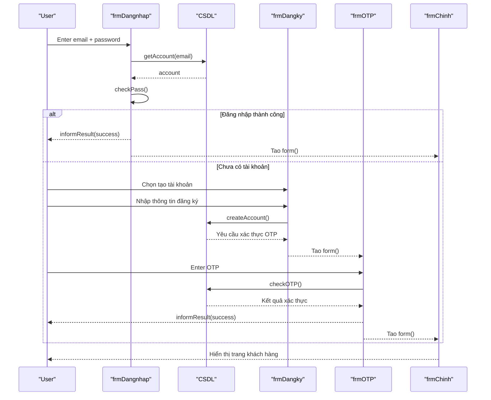

# MilkTea — đặc tả 41 UC

## Danh mục

- UC01 Đăng nhập
- UC02 Đăng ký khách hàng
- UC03 Khôi phục mật khẩu
- UC04 Đăng xuất
- UC05 Xem menu
- UC06 Xem chi tiết món
- UC07 Cập nhật giỏ hàng
- UC08 Đặt đơn tại bàn
- UC09 Tạo đơn tại quầy
- UC10 Theo dõi đơn hàng
- UC11 Xác nhận đơn hàng
- UC12 Ghi nhận thanh toán
- UC13 Bắt đầu chế biến
- UC14 Hoàn thành đơn hàng
- UC15 Yêu cầu hủy đơn hàng
- UC16 Xử lý hủy đơn hàng
- UC17 Tạo đơn thay thế
- UC18 Duyệt hoàn tiền
- UC19 Ghi nhận hoàn tiền
- UC20 Xem lịch sử mua hàng
- UC21 Cập nhật hồ sơ
- UC22 Quản lý tài khoản
- UC23 Thiết lập thông tin quán
- UC24 Quản lý danh mục
- UC25 Quản lý món uống
- UC26 Quản lý công thức
- UC27 Quản lý bàn
- UC28 Quản lý phiên bàn
- UC29 Quản lý nguyên liệu
- UC30 Thiết lập cảnh báo tồn
- UC31 Lập phiếu nhập kho
- UC32 Lập phiếu xuất kho
- UC33 Ghi nhận mẻ sơ chế
- UC34 Ghi nhận hao hụt
- UC35 Xem lịch sử kho
- UC36 Xem báo cáo kinh doanh
- UC37 Thiết lập giảm giá chung
- UC38 Xem thông báo nghiệp vụ
- UC39 Báo cáo sự cố đơn hàng
- UC40 Gắn đơn quầy vào bàn
- UC41 Gửi thông báo thanh toán

| STT | sequence diagram | UC | Ghi chú |
|:-:|---|:-:|---|
| 1 | Khách quét QR và đặt đơn | UC05 - 08| Thể hiện kiểm tra QR, giỏ hàng, tính giá/giảm giá, mở phiên bàn và tạo đơn. Đây là luồng cốt lõi. |
| 2 | Đơn đi qua các bước xác nhận, chế biến và thanh toán | UC11 - 14, UC28 | Có nhiều vai trò. Đặc biệt, thanh toán có thể diễn ra trước, trong hoặc sau chế biến, nên không vẽ thanh toán như điều kiện bắt buộc trước khi bếp làm. |
| 3 | Tạo đơn tại quầy và gắn đơn vào bàn |	UC09, UC40	| Có hai nhánh khác nhau: đơn quầy giữ nguyên nguồn quầy, hoặc thu ngân chủ động gắn đơn vào phiên bàn. |
| 4	| Yêu cầu hủy đơn và xử lý hủy |	UC15–16	| Cần thể hiện khách gửi yêu cầu, server kiểm tra trạng thái, thu ngân chấp thuận/từ chối; yêu cầu hủy không tự hủy đơn ngay. |
| 5 | Duyệt và ghi nhận hoàn tiền |	UC18–19	|Có hai tác nhân khác nhau: quản trị viên duyệt, thu ngân thực hiện hoàn. Tách khỏi thao tác hủy đơn. |
| 6| Bếp hoàn thành đơn và hệ thống trừ nguyên liệu | UC14, UC29, UC33–34 | Làm rõ giao dịch hoàn thành đơn gắn với kiểm tra tồn và ghi biến động kho; nếu thiếu tồn, cần thể hiện nhánh lỗi/rollback. |
| 7 | Nhập kho, xuất kho hoặc ghi mẻ sơ chế | UC31–34 | Phù hợp nếu báo cáo cần mô tả sâu phân hệ kho hai tầng: KHO → BEP, sơ chế THO → SOCHE, hao hụt và kết ca. |
| 8 | Đăng nhập và đăng ký tài khoản |	 UC01–02 | Thể hiện xác thực và phân vai. Đăng ký hiện dành cho CUSTOMER; không thêm bước OTP nếu đang mô tả đúng code hiện tại. |
| 9 | Khôi phục mật khẩu | UC03 | Có thể vẽ riêng để thể hiện yêu cầu token và xác nhận mật khẩu mới. Lưu ý hiện tại đây là token khôi phục, không phải luồng OTP gửi mã độc lập. |
| 10 | Quản trị xem báo cáo/dashboard | UC36 | Có thể vẽ nếu cần thể hiện luồng đọc dữ liệu và tổng hợp báo cáo; độ phức tạp thấp hơn các luồng nghiệp vụ ghi dữ liệu.|

## Mẫu sơ đồ tuần tự số 8 — Đăng nhập và đăng ký tài khoản

Sơ đồ theo dạng form như hình mẫu. Luồng đăng ký có xác thực OTP theo yêu cầu; code hiện tại chưa triển khai OTP.

<!-- mermaid-checked: every participant uses `participant Id as "Label"`, no \n in aliases/messages/notes, every alt/opt/loop closed by end, no `:` inside any alias -->
